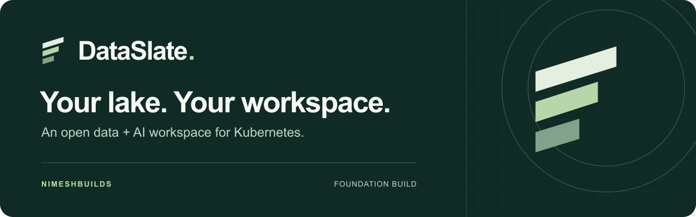

<p align="center">
  
</p>

<p align="center">
  <a href="https://nimeshbuilds.github.io/dataslate/">Explore DataSlate</a> ·
  <a href="https://nimeshbuilds.github.io/dataslate/quickstart.html">Quickstart</a> ·
  <a href="deploy/README.md">Deployment</a> ·
  <a href="docs/implementation/coverage.md">Roadmap</a> ·
  <a href="CONTRIBUTING.md">Contribute</a>
</p>

<p align="center">
  <a href="https://github.com/NimeshBuilds/dataslate/actions/workflows/ci.yml"></a>
  <a href="LICENSE"></a>
  
</p>

# DataSlate

**Your lake. Your workspace.** An open-source Kubernetes platform for data engineering, analytics, machine learning and agents, with **Sylon** as its integrated assistant.

DataSlate is being built as an open-source product with paid support/hosting as a distribution option. It targets teams within one organization, starting with **AWS EKS and S3**. It will support both explicitly managed dependencies and compatible existing services. The complete scope includes Spark, lakehouse governance, ingestion, workflows, notebooks, SQL, visualization, ML, serving, feature stores, agents, memory, apps and sharing.

**Current maturity: implementation foundation with tested backend integrations.** DataSlate implements durable Spark application/notebook execution, incremental file-to-Delta ingestion with verified SQL table publication, governed Trino SQL with result tables/charts, Apache Polaris catalog metadata, authorized lexical/hybrid search, Sylon conversations with reviewable cell proposals and private curated memory, and approved Airflow workflows with schedule/task observation and durable manual triggers. Each has explicit workspace, identity and deployment contracts. Real local Spark/Delta containers, distributed Trino, Polaris and Airflow checks are recorded alongside PostgreSQL and browser evidence. A read-only Kubernetes preflight inventories the rendered installation without adopting or changing services. An [optional pinned Airflow LocalExecutor profile](deploy/airflow/README.md) renders deployments for trusted DAG authors; complete installation still needs qualification. Interactive kernels, Agent Studio, broader platform features and EKS/S3 production qualification remain under development. This is not a production-qualified Databricks replacement yet.

## A familiar workspace, on infrastructure you control

DataSlate brings notebooks, SQL, catalogs, compute and AI into one product experience. The architecture connects mature open-source services through a shared identity, policy and resource model. Teams can use compatible existing services or explicitly provision managed dependencies.

| Available in the foundation | Integration roadmap |
|---|---|
| Python/SQL editors, immutable batch snapshots, governed SQL results and preview charts/profiles | Interactive kernels, collaboration, shared dashboards and full-data aggregates |
| Verified OIDC workspace roles, exact execution/catalog grants, tested Trino filtering/masking | Cross-engine policy consistency, cloud identity and lineage |
| Versioned JSON/Parquet ingestion, verified Delta outcomes and explicit Trino table publication | Cloud file/table qualification, CDC/connectors and scheduled maintenance |
| Apache Spark lifecycle, Polaris metadata, optional managed Trino/Polaris profiles | Native acceleration, operational scaling and recovery |
| Approved Airflow DAGs, schedule/task views, durable UI/API/CLI triggers and an optional rendered LocalExecutor profile | Cluster installation/upgrade qualification, DAG/schedule editing, backfills and production task identities |
| Read-only Kubernetes preflight for rendered resources, ownership and prerequisites | Complete managed installation, live enforcement, upgrades and restore |
| Authorized full-text/pgvector search, embedding gateway authentication, shared UI/API/CLI | Production search relevance, scale and native provider qualification |
| Sylon private history, authorized context, reviewed code proposals and private memory with revision/expiry controls | Agent Studio, durable tools, shared/team memory, ML, serving, apps and sharing |

Each integration has its own validation gate. See the [capability inventory](docs/implementation/coverage.md) for the complete scope and the [validation record](docs/implementation/validation.md) for evidence.

## Repository

| Path | Responsibility |
|---|---|
| `api/` | Go control plane, PostgreSQL, OIDC authorization, Spark/SQL/search/Sylon/publication/workflow controllers and backend adapters |
| `web/` | React/TypeScript workspace, notebook/SQL editors, ingestion, Airflow workflows, results, catalogs, search and Sylon |
| `sdk/python/` | Python SDK and `dataslate` CLI sharing the HTTP API |
| `deploy/` | Helm, read-only installation preflight, managed/external PostgreSQL configuration, EKS guidance and explicit upstream bootstrap |
| `examples/` | API inputs; previews do not execute them |
| `integrations/airflow/` | Airflow hooks/operators that call the DataSlate API from approved DAG tasks |
| `runtime/ingestion/` | Pinned Spark/Delta image, strict file ingestion and real JVM/container qualification |
| `docs/implementation/` | Shared contracts, full coverage and validation status |
| `docs/architecture/` | Current decisions and source-linked research snapshots |

## Run the application for development

The [complete quickstart](https://nimeshbuilds.github.io/dataslate/quickstart.html) covers development and production configuration. For Kubernetes, the [review-bundle generator](deploy/setup/README.md) validates non-secret inputs and renders the core Helm chart with separate migration/runtime database credentials; follow the [staged installation guide](deploy/quickstart.md) through grants, readiness and first-workspace membership.

This loopback workflow develops the Kubernetes product; it is not a separate local-compute edition. Requires Go matching `api/go.mod`, Node 22.19+ and npm. Use separate terminals:

```sh
make dev-api
```

```sh
cd web
npm ci
npm run dev
```

Open the Vite URL printed in the second terminal. The API listens on `127.0.0.1:8080` and the development frontend proxies API requests. Explicit development mode uses a marked development administrator and in-memory storage, which resets when the API restarts. It refuses non-loopback API listening. Production uses verified OIDC and PostgreSQL; the Helm chart cannot select development mode.

For CLI/SDK development with Python 3.11+:

```sh
python3 -m venv .venv
.venv/bin/python -m pip install ./sdk/python
.venv/bin/dataslate status
.venv/bin/dataslate workspace list
.venv/bin/dataslate notebook create --workspace default --file examples/notebook.json
.venv/bin/dataslate spark preview --workspace default --file examples/spark-preview.json
```

See [CLI authentication and commands](cli/README.md), [API documentation](api/README.md) and [deployment documentation](deploy/README.md). Kubernetes installation requires built images, configured OIDC, storage, credentials by reference and compatible operator versions. The [installation preflight](deploy/preflight/README.md) checks the actual rendered chart against one explicit Kubernetes context and reports missing, conflicting or unresolved prerequisites. It does not install, adopt or certify resources. No cloud resources are provisioned by running the development commands.

## Build and validate

```sh
make test-api
make test-sdk PYTHON=python3
make check-web
```

Browser tests and Helm checks are described in their component directories. The CI workflow covers automated checks and isolated PostgreSQL where available; a CI configuration is not evidence that a remote run has occurred. [Validation status](docs/implementation/validation.md) distinguishes local checks from pending live-cloud tests.

`make test-local` combines the source checks, PostgreSQL integration, browser tests and deployment validation after their prerequisites are installed. It requires an isolated `DATASLATE_TEST_DATABASE_URL` with the [selected pgvector extension](deploy/search/README.md) explicitly installed, and fails if hybrid retrieval tests cannot run. It does not provision infrastructure. The [first Spark notebook example](examples/python-batch-notebook.json) and [CLI execution guide](cli/README.md) exercise a deterministic aggregation through a configured engineering binding.

## Product scope and engineering gates

The [complete capability inventory](docs/implementation/coverage.md) is the implementation backlog, including broader ML/AI/app/sharing features. [Foundation contracts](docs/implementation/foundation-contract.md) define the first shared API. [Architecture decisions](docs/architecture/README.md) explain the intended complete system.

The first workflow is ingestion → Spark → governed SQL → charts. Trino supplies the implemented SQL path, and Polaris supplies native Iceberg metadata. UC OSS + Delta + Kyuubi/Spark SQL/Ranger remains a separate planned engine/governance integration. The verified publication controller bridges a completed ingestion receipt to a reviewed Trino Delta catalog backed by Hive Metastore or Glue; see [publication setup](deploy/publication/README.md) and [UI/CLI usage](docs/implementation/publication-clients.md). Native local Spark/Delta/Hive/Trino checks do not establish a joined cloud-lake workflow: cloud credentials, native table reads/writes and equivalent enforcement still need qualification. Approved Airflow 3.4.0 bindings add deployed schedule/graph inspection and one durable manual trigger under an immutable DAG bundle. Airflow owns scheduling and retries; unknown outcomes are read back without another trigger. The native browser proof uses local EmptyOperator tasks, not Kubernetes or cloud execution; see the [workflow contract](docs/implementation/workflow-contract.md). Result caches, notebook outputs, agents and memory must preserve current access restrictions. Managed/external installation must respect ownership and CRD lifecycle.

## License

Original DataSlate code is under [Apache-2.0](LICENSE). Separately distributed dependencies retain their own licenses and [notices](NOTICE). Brand source files and usage guidance are in [brand/](brand/README.md).

DataSlate is an independent project maintained under [NimeshBuilds](https://github.com/NimeshBuilds). It is not affiliated with or endorsed by Databricks or the upstream projects mentioned here. Their names identify interoperability targets, not certification. Hosted services and published runtime packages are not available yet.
