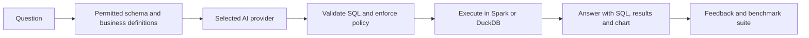
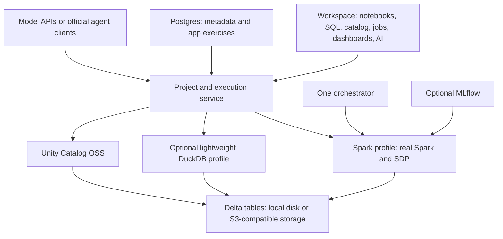

**Databricks at learning scale: research and feasibility assessment**

**Scope update:** The user subsequently chose a Kubernetes-only, production-oriented platform for teams within one organization. The local-first recommendation and delivery estimates below are superseded by [the Kubernetes product blueprint](kubernetes-lakehouse-product-blueprint.md). This earlier report remains supporting research for the Databricks feature inventory, learning use cases, and AI provider integrations.

Research snapshot: September 24, 2026. This reviews the major current product families using official documentation and project repositories. It is not an inventory of every API, cloud variation, connector, or preview flag. Documented features are not necessarily generally available in every region or edition. No candidate stack was installed or benchmarked during this research. Architecture, hardware targets, and delivery estimates below are engineering judgments.

**Recommendation: build a local data engineering learning platform using real open-source engines.** A small product can cover the main journey from ingestion through transformation, streaming, cataloging, SQL, dashboards, ML, and conversational analytics. Full Databricks behavior, performance, security, and managed-service parity is a much larger undertaking. Small datasets reduce compute requirements; they do not remove integration and product complexity.

The strongest opportunity is a single understandable workspace with guided, resettable projects, visible execution plans, and a choice of AI providers. Use existing engines and standards; invest original work in the learning experience, consistent execution and metadata, installation, and the assistant.

Databricks itself already offers a substantial [Free Edition](https://www.databricks.com/learn/free-edition). Its current [limits](https://docs.databricks.com/aws/en/getting-started/free-edition-limitations) include serverless-only compute, fair-use quotas, one small SQL warehouse, five concurrent job tasks, constrained pipelines and serving, and noncommercial use. Therefore free access alone is weak differentiation. Local operation, inspectable infrastructure, portable projects, and model choice are stronger reasons to build.

The following table maps the feature surface to a proposed small-scale implementation. “Real OSS” means the underlying technology is available, not that Databricks' entire surrounding service is reproduced.

| Databricks capability and primary source | Small-scale implementation | Fidelity and scope |
|---|---|---|
| [Compute and runtimes](https://docs.databricks.com/aws/en/compute/): Spark, classic and serverless compute, notebook/job/pipeline execution | Real Apache Spark in local mode; optional standalone master/workers; on-demand worker startup | Real Spark. Cloud fleet management and serverless service guarantees remain outside the first release. |
| [Photon](https://docs.databricks.com/aws/en/compute/photon): native vectorized execution for supported Spark workloads | Ordinary Spark first; optional DuckDB for analytical SQL, or a later native Spark acceleration experiment | Photon is Databricks-specific and cannot be supplied by installing OSS Spark. Alternative engines are not Photon implementations. |
| [Workspace](https://docs.databricks.com/aws/en/workspace): notebooks, SQL, files, collaboration | JupyterLab or marimo plus a unified navigation/catalog/job interface | Start with Python and SQL. Add Scala/R kernels and simultaneous editing only if the curriculum needs them. |
| [Delta Lake](https://docs.databricks.com/aws/en/delta): transactional tables, merge, schema evolution, history, change feeds | Real Delta tables on local disk or an S3-compatible store | High educational fidelity; test table-feature compatibility per engine. |
| [Iceberg](https://docs.databricks.com/aws/en/iceberg) and [Iceberg reads/UniForm](https://docs.databricks.com/aws/en/delta/iceberg-reads) | Optional Iceberg tables and REST catalog integration | Useful second format. Do not independently modify multiple metadata representations of one table. |
| [Lakeflow Connect and ingestion](https://docs.databricks.com/aws/en/data-engineering/) | CSV/JSON/Parquet, Postgres/JDBC, incremental cursors; later selected CDC connectors | Reproduce representative ingestion workflows. A managed connector library is a continuing maintenance commitment. |
| [Zerobus ingestion](https://docs.databricks.com/aws/en/ingestion/zerobus-api-protocols) | Optional event-ingestion endpoint, durable queue, and table writer | Similar learning workflow. No promise of matching protocols or throughput; current Kafka-compatible Zerobus interface is producer-oriented and Beta. |
| [Lakeflow pipelines / Spark Declarative Pipelines](https://docs.databricks.com/aws/en/ldp/concepts/spark-declarative-pipelines) | Real OSS SDP for SQL/Python pipeline definitions, tables, views and dependency execution | Strong reusable foundation. Databricks documents additional managed features including expectations and AUTO CDC; they need separate implementations or explicit exclusions. |
| [Streaming](https://docs.databricks.com/aws/en/data-engineering/) | Real Spark Structured Streaming; file streams initially, Kafka later | Teach checkpoints, watermarks, state, late arrivals, deduplication, replay and failures on small data. |
| [Lakeflow Jobs](https://docs.databricks.com/aws/en/data-engineering/) | Integrate one orchestrator, such as Dagster or Airflow; expose runs, schedules, retries and logs in the workspace | Real scheduled execution; product integration remains our work. |
| [Lakeflow Designer](https://docs.databricks.com/aws/en/data-engineering/) | Start with readable code and pipeline graph visualization; add a limited visual authoring canvas later | Bidirectional visual/code editing is substantial additional scope. |
| [Unity Catalog](https://docs.databricks.com/aws/en/data-governance/unity-catalog/) | OSS Unity Catalog, catalog/schema/table browsing, descriptions, selected permissions and lineage | Real catalog foundation. Managed ABAC, masking, audit, classification and monitoring must be assessed separately. |
| [Federation](https://docs.databricks.com/aws/en/query-federation/database-federation) | One external Postgres connection first; optionally Trino for broader federation | Teach querying external data versus ingestion and external catalog access. |
| [SQL analytics and metric views](https://docs.databricks.com/aws/en/introduction) | Spark SQL, optional DuckDB, query history, saved SQL and versioned metric definitions | Genuine SQL execution. Databricks SQL dialect and warehouse behavior are only partially portable. |
| [AI/BI dashboards](https://docs.databricks.com/aws/en/ai-bi/concepts) | Saved queries with charts, tables and filters; optionally integrate Superset | A useful limited dashboard experience is achievable. |
| [Genie Agents](https://docs.databricks.com/aws/en/genie-agents/concepts) | Curated data spaces, model adapters, controlled SQL tools, result-backed answers and evaluation | High-value custom feature; requires semantic context and testing beyond prompt engineering. |
| [Genie One and Genie Code](https://docs.databricks.com/aws/en/genie) | Business-facing data chat and a separate developer assistant for notebook/pipeline work | Start with narrow workflows; broad autonomous workspace management comes later. |
| [ML and MLOps](https://docs.databricks.com/aws/en/machine-learning/) | MLflow, small scikit-learn/Spark ML training examples, registry and simple prediction endpoints | End-to-end learning is practical. Large GPU training and managed feature serving are optional later modules. |
| [Agents and AI applications](https://docs.databricks.com/aws/en/agents/) | Model APIs, RAG exercises, MCP tools, MLflow traces and evaluation | Representative Agent Bricks-style workflows, without claiming to reproduce its managed optimization systems. |
| [AI Search](https://docs.databricks.com/aws/en/ai-search/ai-search), formerly Vector Search | Postgres with pgvector or a dedicated search component for retrieval exercises | Teach embeddings, metadata filters and hybrid retrieval. Index synchronization and policy enforcement still need integration. |
| [Unity AI Gateway/model services](https://docs.databricks.com/aws/en/ai-gateway/configure-endpoints-beta) | Provider configuration, scoped credentials, request accounting, limits and logs | A small gateway is feasible. Feature maturity differs across current Databricks gateway surfaces. |
| [Lakebase](https://docs.databricks.com/aws/en/oltp/) | Standard Postgres for app state and transactional data, plus a sample analytics sync | Teaches OLTP/OLAP integration. Postgres alone does not reproduce elastic storage, instant branching or managed synchronization. |
| [Databricks Apps](https://docs.databricks.com/aws/en/dev-tools/databricks-apps) | Launch a Streamlit/FastAPI/Node app with scoped data access | Feasible locally; shared hosting and user isolation add work. |
| [OpenSharing, Marketplace and Clean Rooms](https://docs.databricks.com/aws/en/data-sharing) | Dataset-sharing exercise and optional open protocol integration | A small sharing demo is realistic. Marketplace ecosystems and secure enterprise clean-room guarantees are outside the initial scope. |
| [Developer tooling and Declarative Automation Bundles](https://docs.databricks.com/aws/en/dev-tools/bundles) | Git-exportable source, declarative project files, reproducible environments and simple CI | Adopt the concepts; do not promise Databricks REST/CLI compatibility. |
| [Enterprise administration](https://docs.databricks.com/aws/en/introduction) | Single-user local version first; then separate classroom identities, scoped resources and audit records | Multi-tenant isolation, SSO/SCIM, compliance, private networks, HA and billing require a separate operational program. |

Current naming matters when comparing older tutorials: Genie Spaces are now Genie Agents; Genie One and Genie Code are distinct experiences. Older Delta Live Tables material maps to the Lakeflow pipeline family. Current documentation also uses AI Search and Declarative Automation Bundles. The linked product pages above use current terminology.

**The engine plan should preserve what people are learning.** Spark SQL, DataFrame execution and Structured Streaming are parts of the Spark ecosystem, not three unrelated engines we must recreate. Use real Spark for Spark lessons. [Spark Connect](https://spark.apache.org/spark-connect/) provides a client/server interface that lets the UI and Python clients connect to an independently managed Spark process.

Delta Lake is a table format and transaction system rather than a general query engine. The [OSS documentation](https://docs.delta.io/) covers transactions, schema enforcement, streaming, time travel and updates. OSS [Spark Declarative Pipelines](https://spark.apache.org/docs/latest/declarative-pipelines-programming-guide.html) makes real declarative ETL possible locally. These two facts substantially reduce the amount of platform code we need to invent.

Offer an optional DuckDB mode for fast local SQL. Current [DuckDB Delta documentation](https://duckdb.org/docs/current/core_extensions/delta) describes read and write support, but that does not establish support for every Spark/Delta feature combination. Pick one writer initially and qualify cross-engine access. Display the engine and SQL dialect on every notebook or query. Never silently execute a Spark lesson with another engine and imply identical semantics.

[Apache Gluten](https://github.com/apache/gluten) and [Sail](https://github.com/lakehq/sail) are possible later engine experiments. Gluten offloads Spark SQL execution to native engines; Sail implements Spark-compatible interfaces in Rust. Neither is a reason to postpone a standard Spark MVP. Trino, Flink, Ray and other engines should be added for specific lessons, not bundled merely to increase an engine count.

**Similar projects already exist, mostly as integrated stacks or specialized components.** The following comparison is based on repository/documentation inspection, not operational validation. I did not find a mature project covering the entire proposed experience with Databricks-level breadth and a polished beginner workflow.

| Project | What it offers | Fit and gaps |
|---|---|---|
| [Open Lakehouse](https://github.com/open-lakehouse/open-lakehouse) | Apache-2.0 Docker stack combining Spark Connect, Delta/Iceberg, Unity Catalog OSS, Kafka, Airflow, MLflow, SeaweedFS and Postgres | Closest technical starting point. Repository describes Databricks DevRel maintenance, but it is a demo platform and its example slots are placeholders. Evaluate before adopting. |
| [Lakehouse at Home](https://github.com/lisancao/lakehouse-at-home) | Local Spark, streaming, orchestration, catalog and sample-data exercises | Closely aligned with teaching. Predominantly CLI/infrastructure. Its open-source claim was not backed by an identifiable root license in the inspected repository; resolve that before reuse. |
| [OpenLakeForge](https://github.com/malon64/openlakeforge) | Apache-2.0 stack using dlt, Iceberg, dbt/Trino and Dagster, with optional governance and BI | Useful small-team platform reference; alpha packaging, local Kubernetes and a batch-first stack. No default Spark notebook/Genie experience. |
| [ArcaP](https://github.com/Monsau/ArcaP) | Compose-based ingestion, SQL, dbt, dashboards, metadata and local AI/RAG integration | Broad integration reference. Small project, not Spark-centric. Root MIT license does not change the licenses of bundled services. |
| [Dremio Community](https://www.dremio.com/community-edition/) | SQL/lakehouse interface, federation and acceleration | More established SQL experience; not a Spark/notebook/ML platform. Its [edition matrix](https://docs.dremio.com/editions/) places important AI/governance capabilities outside Community; inspect distribution and source licenses separately. |
| [WrenAI](https://github.com/Canner/WrenAI) | Semantic/context engine, SQL validation, SDK, CLI and agent/MCP integration | Strong Mini Genie building block. Current Apache-2.0 core is not a turnkey maintained chat UI; the old UI is frozen and maintained GenBI UI/governance features are commercial. |
| [DuckDB + DuckLake](https://ducklake.select/docs/stable/) | Lightweight analytical engine and transactional lakehouse storage | Good introductory mode. Different format/ecosystem from Spark/Delta; not a whole platform. |
| [marimo](https://github.com/marimo-team/marimo) | Open-source Python/SQL notebook and app experience, with Git-friendly source | Strong frontend candidate. Needs our engine, catalog, scheduler and teaching integrations. |
| [Unity Catalog OSS](https://github.com/unitycatalog/unitycatalog) / [Lakekeeper](https://docs.lakekeeper.io/) | Catalog foundations for Delta/Iceberg or Iceberg-focused deployments | Useful infrastructure components; neither supplies the complete workspace. |

[Vanna](https://github.com/vanna-ai/vanna) is another familiar text-to-SQL project, but its repository is archived as of this research. It is reference material rather than my recommended foundation for a new maintained product. [Apache Kyuubi](https://kyuubi.apache.org/) is worth evaluating later for shared SQL access to Spark and other engines; [Apache Amoro](https://amoro.apache.org/) focuses on lakehouse management, not a full educational workspace.

**Mini Genie is feasible without training a foundation model.** The product is a combination of an existing model, curated business meaning, query tools, and an interface. Databricks' [quality guidance](https://docs.databricks.com/aws/en/genie-agents/tune-quality) emphasizes table descriptions, joins, metrics, instructions and trusted SQL examples. Its [benchmark documentation](https://docs.databricks.com/aws/en/genie-agents/monitor) evaluates answers rather than treating successful SQL execution as sufficient correctness.

For our version, a learner might ask, “Why did revenue fall last week?” The assistant should identify the agreed revenue metric and date boundaries, query permitted tables, show the resulting SQL and chart, then explain the evidence. If refund treatment or the reporting period is ambiguous, it should ask. It should not invent a causal explanation from a single aggregate.

The proposed request path is:

Keep the initial data-chat tools read-only and narrowly scoped. Enforce allowed objects/functions, execution time, result size and process permissions in code. A query beginning with SELECT is not necessarily harmless: engines can expose files, networks and extensibility. [DuckDB's security model](https://duckdb.org/docs/current/operations_manual/securing_duckdb/overview) explains why process isolation matters for untrusted queries.

Maintain reviewed question/answer suites for joins, nulls, duplicates, time zones, ambiguous questions and denied access. Measure result correctness separately for every provider and engine, along with latency and cost. Build an optional coding assistant with separate permissions to propose notebook cells, transformations and job fixes. User review of a proposed write should be part of that workflow.

**Bring-your-own AI needs two different connection types.** A model API returns model output; a coding-agent client additionally owns sessions, tools, authentication and approvals. Do not hide both behind an adapter that assumes they behave identically.

| Connection | Recommended integration |
|---|---|
| OpenAI API | BYOK backend adapter through the [official API](https://developers.openai.com/api/docs/quickstart), with API billing and spending controls. |
| Codex with a ChatGPT plan | Optional local [Codex App Server](https://learn.chatgpt.com/docs/app-server) integration. Official OpenAI documentation supports embedding, managed ChatGPT sign-in, streamed events and approvals. Keep login in that official flow and respect account limits. |
| Claude API | BYOK through [Claude Platform authentication](https://platform.claude.com/docs/en/manage-claude/authentication) or a supported inference provider. Suitable for embedded Mini Genie. |
| Claude subscription | Let users connect their own unmodified Claude Code client to our MCP tools. [Current rules](https://code.claude.com/docs/en/legal-and-compliance) permit hosting/preinstallation under applicable Commercial Terms, preserving built-in authentication with direct user sign-in and billing. They prohibit resale/intermediation and third-party collection of subscription credentials or an app's own Claude.ai login route. Generic embedded subscription login requires a different approval/terms basis. |
| Grok API | BYOK through the [official xAI API](https://docs.x.ai/developers/quickstart). |
| Grok subscription | Optional official Grok Build client adapter. Its [launch](https://x.ai/news/grok-build-cli) provides access for SuperGrok/X Premium Plus users, and [current docs](https://docs.x.ai/build/overview) describe headless and Agent Client Protocol integration. Validate eligibility and limits; this is not a generic subscription-token API proxy. |
| Local model | Optional Ollama adapter using [structured outputs](https://docs.ollama.com/capabilities/structured-outputs) and tool calling. Offline after dependencies/models are downloaded; model quality and memory requirements need measurement. |

Claude billing changes should not be confused with permission to embed login: the [June subscription billing change was paused](https://support.claude.com/en/articles/15036540-use-the-claude-agent-sdk-with-your-claude-plan), while [SDK documentation](https://code.claude.com/docs/en/agent-sdk/overview) separately governs third-party login use. For the first release, advertise API support and connection to the user's official Claude Code client.

Expose a shared MCP tool interface for catalog discovery, table descriptions, read-only queries, job inspection and proposed edits. Provider secrets stay outside prompts and notebooks. Make external data transmission visible in provider setup: local data storage does not mean an external model call is offline. API usage is metered separately from local compute, and subscriptions have provider-specific allowances.

**The proposed platform is modular so a laptop need not run every service.**

The diagram is a proposed integration, not a claim that these packages provide automatic interoperability. Catalog metadata and data access must agree across every route. In particular, arbitrary notebook Python can bypass UI controls if given broad filesystem/storage credentials; meaningful classroom isolation requires scoped workers and storage access.

Start with real Spark, Delta, a catalog, notebooks, saved SQL, one simple scheduled job, charts, and an API-backed assistant. Use the existing Open Lakehouse stack as an integration reference. Choose one orchestrator rather than shipping both Airflow and Dagster. [Dagster's OSS UI](https://docs.dagster.io/guides/operate/webserver) already supplies asset/run/lineage views; [MLflow self-hosting](https://mlflow.org/docs/latest/self-hosting) supplies experiment/model/AI tracking without inventing a tracking server.

Suggested profiles and unbenchmarked engineering targets:

| Profile | Contents | Initial target |
|---|---|---|
| Lite | Notebook/SQL UI, DuckDB, small local data, optional external AI | Aim for ordinary 8 GB laptops; label as SQL/lakehouse introduction. |
| Spark learning | Spark + Delta + catalog, small datasets, limited concurrent services | Aim for a 16 GB laptop; start engines on demand. |
| Full lab | Kafka, orchestrator, MLflow, object storage and optional retrieval/apps | Prefer a 32 GB machine or a shared development server; measure actual peaks. |

Those figures are design targets, not validated minimum specifications. Local LLMs add substantial model-dependent memory requirements. A multi-container cluster on one laptop teaches distributed execution concepts, but cannot demonstrate real multi-machine scalability or independent host failures accurately.

**The first release should prove one complete learning journey.** Use a small retail dataset: ingest orders, build bronze/silver/gold tables, introduce malformed and late records, run incremental transformations, inspect a failed job, repair it, compare historical snapshots, publish a revenue chart and ask the assistant about the result. Add a small ML experiment only after the core pipeline is dependable. Each lesson needs expected results and a reset action.

For two to three experienced engineers working full time and reusing existing components, my rough planning ranges are:

| Milestone | Scope | Estimate |
|---|---|---|
| Integration spike | Start candidate stack; verify Spark/Delta/catalog access, one pipeline, one query and one provider; measure laptop resource use | 1–2 weeks |
| Focused local alpha | Cohesive workspace, starter lessons, job logs/retries, saved SQL/charts, Mini Genie with evaluated sample questions | A further 8–12 weeks |
| Broader beta | Better installer/reset/recovery, streaming lessons, MLflow, provider adapters, limited sharing and compatibility coverage | Roughly 4–6 months total; reassess after the spike |
| Hosted classrooms / enterprise scope | Multi-user code isolation, identity, secrets, quotas, upgrades, backups and operational reliability | Separate sizing exercise; full Databricks parity is not a credible small-project commitment |

The spike should establish a pinned compatibility matrix rather than combining every latest package. Current [Unity Catalog Spark integration instructions](https://github.com/unitycatalog/unitycatalog/blob/main/docs/integrations/unity-catalog-spark.md) specify version-specific Spark/Delta artifacts, while the general [Delta release matrix](https://docs.delta.io/releases/) is less up to date. Cross-check release artifacts and run integration tests on the selected versions and target CPU architectures.

Success criteria for that spike are concrete: a clean install on the target laptop, data surviving restart, catalog-visible tables, a repeatable Delta merge and time-travel example, checkpointed streaming recovery, useful query cancellation/errors, and an assistant whose answers match reviewed results. The next decision is whether the remaining work is mainly product integration or whether a chosen component creates excessive friction.

My go/no-go judgment is **go for an open, local learning platform with real Spark and a provider-independent assistant**. Keep fidelity explicit in the UI: genuine underlying engine, approximate managed workflow, or unsupported Databricks-only behavior. This could cover a broad range of practical learning goals while leaving room to grow into a shared classroom product.
