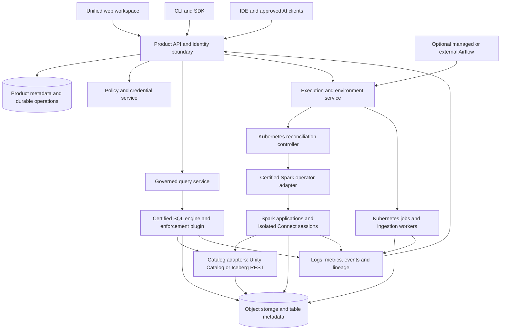

**Kubernetes lakehouse architecture and build plan**

Research snapshot: September 24–25, 2026. Scope confirmed by the user: one Kubernetes installation serving teams within one organization. Kubernetes is the deployment target; a local desktop edition is outside this plan. This is a proposed product architecture supported by current primary documentation and repository inspection. It is not a tested deployment, performance benchmark, security certification, or implementation commitment.

**Expanded requirements:** Existing S3/ADLS/GCS lakes, dynamic dataset discovery, Snappy-Parquet Delta ingestion, scheduled table maintenance, OAuth/workload-identity model connections, and integrated notebook/SQL AI assistance are specified in [the cloud lake and AI experience extension](cloud-lake-and-ai-experience.md). This extension is part of the product scope. It also updates the UniForm freshness assessment using newer tagged releases.

**Latest consolidated component plan:** [Components, names, results visualization and agent memory](platform-components-and-naming.md) is the current stack recommendation. The user has asked to replace the provisional DataSlate/Doot names; **LakeMantle / Sylun** is the leading suggestion from a preliminary search, pending a naming decision. Earlier names in examples and filenames remain historical. [The product contract](dataslate-product-contract.md) specifies the shared UI, code assistance, Agent Studio, secure internal-agent lifecycle and configuration hierarchy. A scoped internal-agent builder is part of the first production AI capability; arbitrary framework/serving breadth is qualified separately.

**The product should own the complete user workflow.** Users sign in, select a workspace, connect data, develop transformations, execute or schedule them, inspect results, publish data products, assign access, and ask an assistant about data or failures. The UI, CLI, and public API all operate on the same resources and permissions. Mature components perform execution and storage, while our software provides a coherent resource model, reconciliation, environment management, governance integration, and user experience.

This is substantial platform engineering. A visually integrated console is useful only if credentials, versions, failure states, permissions, data freshness and lifecycle operations are also integrated. Broad compatibility needs to be earned through a published support matrix. “All packages,” “all Kubernetes clusters,” and “all Databricks behavior” cannot be responsible release promises.

**The strongest product requirements are behavioral.**

| Requirement | Observable behavior |
|---|---|
| A single product | Every main operation is available through our UI and API, with a consistent CLI. Backend consoles are optional diagnostic links. |
| Kubernetes deployment | Installation supports existing infrastructure and explicitly managed dependencies, with preflight checks and an upgrade plan. |
| Multi-team operation | Identity, workspaces, compute quotas, secrets, data policies, logs and results respect team boundaries. |
| Reproducible work | A scheduled run references an immutable source revision and runtime environment, plus parameters and data references. |
| Real Spark | Batch jobs and interactive sessions execute on upstream Spark with supported extensions. |
| Reliable outcomes | Cancellation, retries, duplicate submissions, controller restarts and partial commits have explicit semantics. |
| Consistent governance | A policy is enforced by the actual execution path, including SQL, notebooks, AI tools and exports. Unsupported enforcement combinations are blocked. |
| Efficient operation | Idle compute can stop; queued work exposes its reason; resource use and native execution coverage are measurable. |
| Understandable failures | A run page connects source code, operator state, scheduling issues, Spark stages, logs, input data and recovery actions. |
| Portability | Projects, SQL, notebooks, images, open table formats and metadata are exportable through documented interfaces. |

**Use three architectural layers with explicit ownership.** The diagram describes logical responsibilities; the first implementation should use a modular control-plane application rather than a large set of independent microservices.



The SQL/catalog arrow does not imply that any SQL engine can safely use any catalog. The supported combinations and security boundary are specified later. Airflow calls the product execution API; it does not bypass policy by directly creating arbitrary workloads. The frontend never receives operator credentials or a cluster-admin kubeconfig.

**The control plane is the principal software we build.** My recommended implementation is a TypeScript/React web application, a Go API and Kubernetes controller, and Python SDK/runtime integration packages. This is an engineering choice, not a requirement imposed by the dependencies. Go fits Kubernetes reconciliation and streaming APIs; Python belongs close to notebooks, connectors and ML. Reuse a notebook protocol and editor components rather than inventing a kernel protocol.

Begin with a few deployable processes: API/web, reconciliation and operations worker, authenticated query/kernel gateway, and isolated workload workers. Use Postgres transactions and a durable outbox to prevent accepted operations from disappearing after a process failure. Add a separate messaging system only when measured event throughput or integration needs justify it.

The product model should include Organization, Workspace, Project, Connection, SecretReference, Environment, EnvironmentBuild, ComputeProfile, NotebookRevision, DataAsset, JobDefinition, Run, RunAttempt, Query, Dashboard, SemanticDefinition, Policy, Grant, and AuditEvent. Every relevant resource carries a stable ID, workspace ownership, version, creation actor and audit history. Display names are not authorization identifiers.

| State or artifact | Authoritative owner |
|---|---|
| Project definitions, grants, environments, desired runs | Product API/Postgres |
| Physical workload state | Kubernetes and the relevant operator; product stores an observed projection |
| Governed SQL engine/session lifecycle in profile A | Kyuubi; product observes operations and applies admission/configuration policy |
| Task dependencies and schedule state when Airflow is selected | Airflow; product publishes versioned definitions and correlates their runs |
| Actual table schema, transaction history and commits | The selected table format and authoritative catalog |
| Source revisions, notebook snapshots, runtime images | Git/object storage/OCI registry, referenced by immutable IDs |
| Operational logs, metrics and traces | Configured telemetry backends, indexed by product correlation IDs |
| Lineage | Captured execution events with provenance and completeness indicators |

Avoid conflicting truth. For example, the product must not report success merely because a Spark pod exited successfully: ingestion publication, data checks and catalog visibility can still be incomplete. Likewise, the product database should not independently rewrite a table's schema behind its catalog.

**The UI should make backend integration feel natural.** Navigation can contain Workspace, Data, Develop, Pipelines, Runs, Compute, AI, and Administration. These are task-oriented views over shared resources. A table should have a single page with schema, preview, ownership, quality, freshness, lineage, permissions and downstream use. A run should have one timeline, even if it includes a connector pod, an Airflow task and a SparkApplication.

The primary journey is: create connection → preview/schema contract → select ingestion mode → create table → open notebook or SQL → save transformation → schedule immutable revision → inspect result → publish dashboard/semantic definition. Each step should carry forward the same project, connection, identity and environment automatically.

Use reusable JupyterLab notebook/editor components and Jupyter Server kernel/session APIs behind our identity boundary. Their published interfaces make a custom notebook experience practical. Collaborative document editing, running kernel state and scheduled reproducibility are separate concerns: sharing a document must not silently share execution credentials. A scheduled notebook starts in a clean environment; out-of-order interactive state is not a deployable artifact. [JupyterLab component reuse](https://jupyterlab.readthedocs.io/en/stable/extension/components.html), [Jupyter Server API](https://jupyter-server.readthedocs.io/en/latest/developers/rest-api.html).

The UI should display friendly states such as “waiting for team compute quota,” “image downloading,” “schema check failed,” or “data committed; catalog publication pending.” Advanced details expose the pod, application, SQL plan or raw logs without requiring everyone to understand them. Preserve Spark and SQL error details alongside the explanation. Accessibility, keyboard navigation, command search, empty states and recovery actions are part of the product quality work.

**The UI, CLI and API must share the same contract.** Define an OpenAPI specification and integration tests before implementing screens independently. Support asynchronous operations, idempotency keys, pagination, optimistic concurrency and resumable event streams. Authenticate users through OIDC; use appropriate OAuth flows for CLI login and scoped machine credentials for CI. Record both the initiating human and execution identity for scheduled or delegated work.

The following are proposed command shapes, not currently available commands:

```text
dataslate auth login
dataslate project validate --file project.yaml
dataslate project apply --file project.yaml --dry-run
dataslate job run orders-daily --environment production
dataslate run logs <run-id> --follow
dataslate run cancel <run-id>
dataslate catalog permissions explain <asset-id>
dataslate doctor --workspace finance
```

Applications should depend on our stable Run API, not the upstream SparkApplication schema. A project manifest describes business resources and runtime requirements; the server validates it and produces an execution plan. Advanced Spark configuration is an allowlisted escape hatch, subject to policy. Arbitrary pod templates, service accounts, image overrides and storage paths cannot be ordinary-user inputs.

**Each run needs a complete lifecycle.** An accepted job should proceed through these steps:

1. Authenticate the caller, resolve the workspace and authorize the exact job, environment, connections and output assets.
2. Freeze source revision, environment image digest, parameters, engine/profile version, execution identity and references to relevant policies. Input snapshots are pinned where the job semantics require them; a streaming run records checkpoint and source-offset semantics instead.
3. Persist the Run and an operation event atomically. Repeated submissions with the same scoped idempotency key return the same logical run.
4. Check admission, quota and runtime readiness. Pending work explains the blocking condition instead of disappearing into a generic spinner.
5. Resolve the certified operator adapter and create a uniquely identified SparkApplication for a run attempt, or the appropriate Kubernetes workload for a connector or Python task.
6. Watch observed state, reconcile after disconnects, and correlate operator conditions, Kubernetes events and engine events. Recover expired watches with a relist; do not rely on a single process holding an in-memory polling loop.
7. Enforce the selected quality/publication protocol. Blocking checks validate staged/candidate output before it becomes visible; subsequent monitoring checks cannot promise that failed data was never published. Record table snapshots, lineage and artifacts before declaring the complete product workflow successful.
8. Retain metadata/logs according to policy and clean up compute. A cancellation must stop operator-level resubmission and scheduler retries as well as terminate current pods.

Use a normalized state machine such as Accepted → Queued → Preparing → Starting → Running → Publishing → Succeeded, with Failed, CancelRequested, Cancelled and TimedOut branches. Preserve the original backend state and reason; normalization must not erase evidence. Store a separate RunAttempt record for each retry.

Maintain a separate Unknown/Reconciling observation condition. Losing Kubernetes connectivity does not mean a workload failed or stopped. Mark cancellation complete only after termination is observed, or show cleanup uncertainty explicitly. Fence cancellation at the logical run/task: reject delayed Airflow retries and new attempts, reconcile the scheduler state, and record when completion won the cancellation race.

Separate permission to edit a draft, deploy a revision, trigger that deployed revision and select its run-as identity. A user allowed to replace a privileged job's code, dependencies, image or secret references can usually exercise that job's privileges. Authorize the immutable deployment as a whole and require equivalent delegation rights for changes. A trigger-only user cannot supply executable code or unrestricted configuration through parameters. These checks apply within a workspace as well as across workspaces.

Assign one owner for whole-job retries. For a standalone run, the product execution service owns retries; for an Airflow-managed workflow, Airflow owns logical task retries and each try maps to an explicit product attempt. Disable independent whole-job resubmission in the other layers for that run. Spark still owns task/stage recovery, which is a different mechanism. Reevaluate current authorization before each attempt; freezing an old policy reference must not override a subsequent revocation. Reconciliation must adopt only workloads carrying verified product ownership IDs, not arbitrary same-name resources.

Do not promise exactly-once side effects for arbitrary jobs. Use format-native atomic commits, idempotent writes, source offsets and explicit recovery logic. A failure after data commit but before status acknowledgement requires checking the commit, not blindly running an append again.

**Runtime environments are a product feature.** Support curated, versioned profiles: Spark/Python/SQL, plain Python, and later Scala/JVM and ML/GPU variants. Each profile pins Spark, Java, Scala ABI, Python, table-format connectors, catalog clients, JDBC drivers, lineage libraries and any native extension. Build immutable OCI images with lockfiles, signed digests, provenance and an SBOM. The build worker needs isolation and restricted access; package installation executes third-party code.

Offer three package classes: certified packages included in supported profiles; user-added dependencies that must resolve and pass smoke tests; and restricted extensions requiring administrator review. Notebook experimentation can allow an ephemeral package overlay, but scheduling should capture or rebuild the environment explicitly. Do not mutate a shared cluster's libraries for one user's notebook. Mirror approved images/wheels/JARs for air-gapped installations and qualify x86/ARM/GPU profiles separately.

**Governance requires separate resource and data decisions.** A user being allowed to launch compute does not imply access to every table. A user being allowed to query a table does not imply permission to download its raw files. The product policy service should answer both resource actions and data entitlements, while execution services enforce the applicable rules.

For the confirmed internal-team model, begin with one organizational identity boundary and namespace-per-workspace or trust boundary, separate workload service accounts and scoped storage prefixes. Groups map to roles such as Platform Administrator, Workspace Administrator, Engineer, Analyst, Steward and Viewer. Data access is granted independently on catalog/schema/table/column resources. A platform administrator should not automatically become a business-data reader through a convenient application role; infrastructure administrators remain trusted operators at the deployment boundary.

Use OIDC Authorization Code with PKCE for browser sign-in, secure server-managed sessions, issuer/audience validation and appropriate machine authentication. Connect an existing IdP first; optionally deploy Keycloak when one is needed. MFA and upstream identity lifecycle belong with the IdP. Design deprovisioning, token expiry and revocation propagation deliberately, including running notebooks and cached results. Secrets are references in our database, resolved from a configured secret store using scoped identities; they are not placed in project YAML or AI prompts.

The essential distinction is between governed analysis and privileged engineering:

| Access path | Enforcement requirement |
|---|---|
| SQL editor, dashboard, data preview, AI data query | Server-side identity and row/column enforcement in a qualified SQL execution path; no raw-file credentials in the client |
| Notebook using governed query APIs | Same user identity and policies as the SQL editor; returned data has already been filtered |
| Arbitrary Python/PySpark with raw table access | User/job must be entitled to the raw input. Row-level restrictions cannot be claimed once those raw files and credentials are accessible. |
| Approved engineering pipeline | Dedicated execution identity, authorized source/output scope, immutable code, audit trail and appropriate promotion approval |
| Logs, result downloads, caches, lineage and notebook outputs | The same workspace/data confidentiality boundary; these are alternate data-access paths |

NetworkPolicy, Kubernetes RBAC and catalog grants perform different jobs. Enforce pod security, no privileged/host mounts, narrowly scoped service accounts, restricted metadata-service access, resource limits, and workload-specific egress. Namespace separation is not a substitute for a storage policy. Preserve an option for dedicated node pools or stronger runtime isolation for sensitive teams. Public mutually hostile tenancy is a later security product, outside this first release.

Spark drivers that create executor pods need special containment. Arbitrary driver code can call Kubernetes directly and try to select another service account or mount a different secret. Enforce admission rules for executor identity, mounts, image, pod security and ownership, or separate execution namespaces by privilege boundary. A workspace namespace containing several privileged service accounts is unsafe if its users can create arbitrary pods. UI validation alone does not close this route. [Kubernetes RBAC escalation guidance](https://kubernetes.io/docs/concepts/security/rbac-good-practices/).

Policy changes should be versioned, auditable and testable in a “preview as user/group” UI. Publish only after affected enforcement adapters acknowledge the policy, and fail closed for unsupported or unavailable enforcement. Cache keys must include identity/entitlements, policy version and relevant table snapshot. Revocation blocks future access and invalidates server-managed results; it cannot retract files someone already downloaded.

**Catalog and row-security choices need an explicit compatibility gate.** Unity Catalog OSS is a required first-class integration for the requested product, but its name alone does not establish managed-Databricks governance parity. A credible implementation must specify the table format, authoritative catalog, writer, reader, access plugin and credential boundary as one tested profile.

Current upstream Trino documentation no longer supports its old Unity Catalog HTTP integration in recent releases. Its current route is the Iceberg connector against an Iceberg REST catalog. UC's own example uses this route to query a Delta UniForm table. This is different from native Trino Delta support and different from a general Iceberg write catalog. [Trino catalog ecosystem](https://trino.io/ecosystem/data-lake.html), [UC Trino integration](https://docs.unitycatalog.io/integrations/unity-catalog-trino/).

UniForm freshness is version- and execution-path-dependent. Delta 4.3 added atomic/incremental conversion, and 4.4 added atomic initialization; other synchronous/asynchronous paths remain. Qualify table commit, catalog metadata publication and reader-cache freshness together. The product must test writes, schema changes, deletions, snapshots and permission changes, and must not allow an Iceberg client to independently commit to a Delta-owned table. [Delta 4.3 release](https://github.com/delta-io/delta/releases/tag/v4.3.0), [Delta 4.4 release](https://github.com/delta-io/delta/releases/tag/v4.4.0), [Delta UniForm](https://docs.delta.io/delta-uniform/).

Given the explicit Spark and Unity Catalog requirements, qualify **UC OSS + Delta + Spark SQL through Kyuubi/Ranger first**. This is the best product-fit candidate, not an already certified stack. Kyuubi's authorization extension supports row filtering and masking, and its source includes Delta authorization tests. Those tests use Hive/DeltaCatalog; inspection found no UC-specific test coverage. Catalog identifier extraction, authenticated user propagation, Ranger resource mapping and escape prevention are therefore release-blocking integration tests. [Kyuubi AuthZ](https://kyuubi.readthedocs.io/en/v1.12.0/security/authorization/spark/overview.html), [Delta authorization tests](https://github.com/apache/kyuubi/blob/v1.12.0/extensions/spark/kyuubi-spark-authz/src/test/scala/org/apache/kyuubi/plugin/spark/authz/ranger/DeltaCatalogRangerSparkExtensionSuite.scala).

| Profile | Why consider it | Critical qualification | Decision |
|---|---|---|---|
| A: UC + Delta + Kyuubi/Spark SQL + Ranger | Closest fit; Spark SQL across engineering and analysis | UC identifiers and privileges, engine-side filters/masks, effective-user identity, prohibited SQL escape paths | Qualify first; default if it passes |
| B: UC + Delta UniForm + Trino/OPA | UC/Delta with a separate SQL serving engine | Read-only bridge, fresh metadata publication, feature compatibility, backend credential confinement | Optional later profile; additional moving parts |
| C: Polaris + native Iceberg v2 + Trino/OPA, with Spark engineering | Direct REST catalog interoperability; clear query enforcement interfaces | Product identity, policy and storage integration still need tests | Fallback or alternate default if A fails; preserve a separate real UC/Delta profile |

Choose one primary SQL/policy profile for v1. Do not install Ranger and OPA by default simply to advertise both. If A fails, explicitly decide whether to fund the missing connector work or launch C with a narrower UC security promise. Unsupported fine-grained access must be refused, never silently downgraded. One logical table must have one authoritative writable catalog; the UI may present multiple catalogs without maintaining conflicting writable copies.

For protected tables, the trusted query service uses a scoped backend catalog/storage identity; Ranger or OPA evaluates the authenticated human or service principal. Log both identities. Do not give an analyst a UC table-read credential that can vend raw-file access and then claim the query service's row filter protects that separate path. Analyst notebooks use the governed query API, or explicitly materialized authorized extracts with expiration and lineage. Engineers with full-table grants use isolated Spark sessions/jobs. The UI can make both routes intuitive while displaying their different privileges.

The restricted SQL service must block arbitrary language execution, unapproved UDF/JAR loading, raw-file paths, unsafe connectors, and configuration changes that disable authorization or reveal credentials. These require backend enforcement, including JDBC clients, not hidden UI controls. A shared Spark Connect server carrying full-table credentials is not an alternative RLS boundary.

UC v0.6.0 source requires metastore OWNER for its Iceberg config/list/load endpoints. Consequently profile B has an especially sensitive backend token and must not expose that endpoint or token to user workloads. A UC instance per security domain can limit scope, with added operational cost. This is a specific versioned observation, not an assumption about every future UC release. [UC Iceberg service source](https://github.com/unitycatalog/unitycatalog/blob/v0.6.0/server/src/main/java/io/unitycatalog/server/service/IcebergRestCatalogService.java).

OPA is a policy decision component, not an automatic filter over arbitrary Spark code. Trino explicitly supports row-filter and column-mask hooks; our implementation must configure them and preserve authenticated identity. This is why the query execution boundary matters. [Trino OPA access control](https://trino.io/docs/current/security/opa-access-control.html).

**Lineage and observability should be visible throughout the product.** Give each request, run, attempt, application, query and publication a correlated ID. Send traces, metrics and logs through OpenTelemetry-compatible integrations, expose Prometheus metrics, and attach to an organization's existing telemetry stack where possible. Separate audit retention from short-lived debug logs. Redact secrets while retaining enough evidence to diagnose failures. [OpenTelemetry signals](https://opentelemetry.io/docs/concepts/signals/).

Use OpenLineage for supported Spark/workflow events and capture product-level events for connector and publication stages. Display confidence/completeness: arbitrary UDFs, custom readers and missing integrations can produce partial lineage. Never infer a complete governance lineage graph merely from a notebook's text. [Spark lineage architecture](https://openlineage.io/docs/integrations/spark/main_concept/).

**The assistant should use the same product tools and permissions.** Provide separate data-analysis and engineering capabilities. Data analysis retrieves permitted schemas and semantic definitions, submits queries through the governed query API and returns results with SQL, provenance and freshness. Engineering assistance inspects authorized code/logs, explains failures and proposes reviewed changes. It should not hold a reusable administrative token.

Support API-based model providers first, plus optional user-owned official agent-client integrations through MCP or the relevant documented protocol. Our earlier feasibility report covers provider-specific subscription restrictions. A shared Kubernetes service should not pool personal subscription credentials. Store provider configuration per organization/workspace, disclose external transmission, cap spend, and support a separately operated local-model endpoint where appropriate.

Evaluate answers against actual query results, ambiguous business definitions, permissions, stale metadata and adversarial instructions in data. Test the assistant under the same user roles as SQL. Semantic definitions are versioned product assets reused by dashboards and AI, not buried in one chat prompt. Neither prompts nor generated SQL are security controls.

**Efficiency should be measured across the whole workflow.** Use immutable image layers, pre-pulled popular runtimes, bounded warm pools for interactive sessions, idle shutdown and admission queues. Separate interactive and batch capacities to avoid an ingestion backfill starving analysts. Requests/limits, storage throughput, shuffle behavior and object-store latency often matter more than adding another engine.

Pool clean, unassigned capacity, or permanently bind a session to its authorized identity/trust domain. Never reassign a live driver/kernel containing credentials, cached DataFrames, temporary views, files or outputs to another identity. Terminate and recreate the security context before reuse; a cleared notebook screen is not a reset.

Kubernetes resource quotas cap usage; they do not alone provide fair workload admission. An optional queue integration such as Kueue can manage quotas and admission, but support must be qualified for the chosen Spark operator/workload type. Report pending reasons and actual allocation, distinguish those from estimated financial cost, and do not imply Kubernetes provides unlimited serverless capacity. [Kueue overview](https://kueue.sigs.k8s.io/docs/overview/).

Benchmark engine profiles on the same input snapshots and result checks: simple scans, joins, skew, decimal arithmetic, time zones, UDFs, nested data and CDC writes. Collect end-to-end latency, startup latency, concurrency, CPU/memory, storage IO and idle consumption. A native engine's vendor benchmark is not a product performance result.

**The initial component distribution should be deliberately small.** The table is a recommended bill of materials, subject to the compatibility gates above. A component having a Kubernetes deployment does not mean it needs its own operator or should always be installed.

| Capability | First implementation / mature backend | Kubernetes counterpart and ownership |
|---|---|---|
| Workspace, API, CLI, resource authorization | Our product; React/TypeScript UI, Go backend/controller, Python SDK | Namespaced Deployments, Services, configuration and migration Jobs |
| SSO | Existing organization OIDC provider; optional Keycloak | External endpoint or separately managed Keycloak deployment/operator |
| Product/catalog/workflow metadata | PostgreSQL; distinct DBs and roles | External production database or optional CloudNativePG plus Barman Cloud plugin |
| Object storage | Certified organization-owned object store | External endpoint; optional separately provisioned Rook/Ceph profile |
| Spark batch execution | Upstream Apache Spark | Apache Spark Kubernetes Operator by default; explicit Kubeflow adapter for existing installs |
| Interactive engineering | Jupyter kernels and Spark Connect | Isolated kernel/server pods and operator-specific long-running Spark applications behind authenticated gateways |
| Governed SQL | Kyuubi + Spark SQL + Ranger, candidate A | Private Kyuubi/policy services and controlled Spark engine workloads; qualification required |
| Kyuubi HA coordination | ZooKeeper for the documented production HA profile | Existing compatible ensemble or separately managed ensemble; include its persistent state and operations in profile A |
| Catalog and table format | UC OSS + Delta, candidate A | Catalog service with durable SQL metadata; actual table files in object storage |
| Alternative lakehouse profile | Polaris + Iceberg v2 + Trino/OPA | Catalog/policy services; Trino coordinator and worker Deployments; separately certified profile |
| Native Spark acceleration | Optional Comet after correctness tests; bounded Gluten evaluation | Separate immutable runtime image and compatible node placement; no separate always-on engine needed |
| Ingestion | dlt OSS extraction + controlled Spark publication | Scoped Kubernetes Jobs with persisted connector state and staging manifests |
| Workflow scheduling | Airflow, managed or external | Supported Helm deployment/existing API; trusted product-generated DAGs |
| Declarative transformations | Spark Declarative Pipelines; optional later dbt integration | Versioned source executed in certified Spark/SQL runtimes |
| Streaming / CDC | Structured Streaming; optional Debezium + Kafka Connect | Existing Kafka preferred; optional Strimzi-managed Kafka/Connect; long-running Spark workloads |
| Tracking and model registry | Optional MLflow module | Private service, database and scoped artifact storage; isolated training Jobs |
| AI assistant | Our semantic assets, tool orchestration, evaluations and provider adapters | API workers; external model APIs or explicitly configured self-hosted model endpoint |
| Operational telemetry | OpenTelemetry and Spark event logs; integrate existing metrics/logs | Collectors plus existing backends; optional managed observability profile after footprint review |

Core dependencies and optional modules should appear in an administrator's plan with version, owner, resource request and health checks. Ordinary users see capabilities such as “Create pipeline” and “Start notebook.” They should not need to navigate a list of infrastructure products.

**Spark operator compatibility is a real API problem.** Apache's current Spark Kubernetes Operator 1.0.0 uses `spark.apache.org/v1`; Kubeflow's current operator uses `sparkoperator.k8s.io/v1beta2`. Both have resources called SparkApplication. Detection by kind name alone is incorrect. The Apache release supports Spark 4.0–4.2 and Kubernetes 1.34–1.36; its supported matrix must constrain the initial distribution. A different existing cluster needs a separately supported lane. [Apache operator release](https://github.com/apache/spark-kubernetes-operator/releases/tag/1.0.0), [Kubeflow releases](https://github.com/kubeflow/spark-operator/releases).

Implement an internal operator interface for capability discovery, submit, observe, cancel, logs/metrics references and session endpoint discovery. Each adapter normalizes lifecycle states while preserving native details. Discover CRD group, served/stored versions, schema, controller image and health, watch scope, selectors, webhooks and namespace RBAC. Report Found → Compatible → Authorized → Verified separately. A canary confirms the integration before it is marked ready. Do not adopt resources based on matching names or labels alone; check product ownership and Kubernetes UIDs.

For interactive engineering, Spark Connect separates the notebook client from the Spark driver. It does not include built-in authentication and does not support SparkContext/RDD APIs. Use authenticated gRPC routing and isolated servers per user or explicitly trusted security domain. Offer a classic batch Spark profile for packages that require older execution APIs. Do not promise all PySpark libraries work through Connect. [Spark Connect overview](https://spark.apache.org/docs/latest/spark-connect-overview.html).

Governed SQL has a different owner: Kyuubi normally launches and manages Spark SQL engines through Spark's Kubernetes submission path. These are not automatically SparkApplication resources managed by our chosen operator. Our Kyuubi adapter observes sessions/operations and controls permitted configuration, identity, admission and engine lifetime; it must not race a second reconciler over the same engine. The documented production HA profile requires an external ZooKeeper ensemble. Include that dependency and its measured footprint; an embedded development instance is not HA. [Kyuubi Kubernetes engines](https://kyuubi.readthedocs.io/en/v1.12.0/deployment/engine_on_kubernetes.html), [Kyuubi HA](https://kyuubi.readthedocs.io/en/v1.12.0/deployment/high_availability_guide.html).

A starting **certification candidate**, not a tested bundle, is Spark 4.1.3 / Scala 2.13 / a pinned supported JDK / Delta 4.4.0 using its Spark-4.1-specific artifacts, plus matching UC connector artifacts. Delta 4.4 publishes distinct artifacts for different Spark lines; the generic one targets Spark 4.2, while UniForm in that release supports 4.1 rather than 4.2. Version pinning therefore affects functionality, not just installation reproducibility. [Spark downloads](https://spark.apache.org/downloads.html), [Delta 4.4 release](https://github.com/delta-io/delta/releases/tag/v4.4.0), [UC 0.6 release](https://github.com/unitycatalog/unitycatalog/releases/tag/v0.6.0).

Profile A also needs Kyuubi engine/AuthZ artifacts built for the same Spark line and Scala ABI. Its quick-start warns that default prebuilt artifacts target Spark 3/Scala 2.12; server-version support alone does not select the right JARs. [Kyuubi requirements](https://kyuubi.readthedocs.io/en/v1.12.0/quick_start/quick_start.html).

**Native acceleration is feasible; Photon equivalence is not a valid promise.** Photon is Databricks' native execution engine. Our product can offer a comparable category of feature using native Spark acceleration, while documenting its own supported operations and measured performance. [Photon documentation](https://docs.databricks.com/aws/en/compute/photon).

Start with vanilla Spark as the reliable reference. Evaluate Comet 1.0 first because its release matrix includes Spark 4.1.3; treat it as experimental until it passes our data-format, credential and result tests. Its tagged docs identify affected cases involving ABFS object-store caching, legacy date rebasing, invalid UTF-8 and ANSI semantics. Disable affected profiles or verify fixes before certification. [Comet installation matrix](https://github.com/apache/datafusion-comet/blob/1.0.0/docs/source/user-guide/latest/installation.md), [Comet compatibility](https://github.com/apache/datafusion-comet/blob/1.0.0/docs/source/user-guide/latest/compatibility/index.md), [scan compatibility](https://github.com/apache/datafusion-comet/blob/1.0.0/docs/source/user-guide/latest/compatibility/scans.md).

Gluten/Velox is a serious second candidate. Its current Delta feature table certifies particular Spark/Delta combinations and marks native writes experimental; UniForm is untested there. Broader Spark compatibility does not certify our selected Delta/UC stack. Run a bounded comparison and initially support one accelerator. Surface native execution coverage, fallback causes and semantic limitations in the plan viewer. Never trade correctness or policy enforcement for a favorable benchmark. [Gluten Delta support matrix](https://github.com/apache/gluten/blob/v1.7.0/docs/get-started/VeloxDelta.md).

Qualify acceleration and authorization together. Run differential row-filter, column-mask and denied-access cases with native execution enabled, including optimizer rewrites, fallback and UDF paths. Equal results on unrestricted tables do not establish that the combined AuthZ/native extension order preserves policy enforcement. Acceleration may initially be limited to privileged engineering profiles while the governed SQL combination is being tested.

**Ingestion needs an end-to-end correctness contract.** For the first release, certify file upload, object-store files, PostgreSQL batch/incremental ingestion and a constrained REST connector pattern. A connector catalog can grow later. Each connector must declare authentication, supported types, cursor/primary key behavior, pagination, deletion handling, schema evolution, backfills, rate limits and recovery semantics.

Default to dlt OSS → immutable staging files → candidate transformation and blocking quality checks → controlled table commit/publication → lineage and post-publication monitoring. Persist a manifest linking source window, connector state, staged objects and resulting table snapshot. Choose a format-specific staging/promotion protocol before promising quarantine. For an already visible table, delaying catalog registration does not hide a newly committed version. Unsupported write/check combinations must offer explicit post-publication monitoring or be refused, rather than pretend to be atomic quality gates. Direct table writers can be certified later. dlt's OSS filesystem destination supports multiple formats, but dedicated dltHub destination documentation includes commercial features; distinguish them. [dlt OSS filesystem destination](https://dlthub.com/docs/dlt-ecosystem/destinations/filesystem), [OSS and dltHub distinction](https://dlthub.com/docs/hub/getting-started/oss-and-dlthub).

Incremental cursor loading is not CDC. In particular, a timestamp cursor does not automatically capture deletes. When log-based CDC is needed, use Debezium with supported sources, Kafka Connect and existing Kafka or an explicitly enabled Strimzi profile. Store operation, source position, key and ordering information; merge deterministically so replay cannot resurrect a row deleted by a newer event. Treat a broken source log position or schema contract as a visible recovery state. [Debezium PostgreSQL connector](https://debezium.io/documentation/reference/stable/connectors/postgresql.html), [Strimzi deployment](https://strimzi.io/docs/operators/0.50.1/full/deploying).

Streaming jobs have different operational needs from batch: persistent checkpoint ownership, graceful stop, restart, watermark/state metrics, late-data handling, lag alerts and exclusive writers. A backfill uses deliberately chosen source bounds/checkpoints. Streaming state cannot be recreated by blindly rerunning the newest notebook. Do not promise universal exactly-once ingestion; certify each source/sink/commit/checkpoint combination with fault injection.

Airbyte is a useful optional existing-system adapter. Its platform/connectors currently use ELv2, so it is not a blanket permissively licensed OSS dependency for a competing distribution. Decide on the actual redistribution/hosting model before bundling it. [Airbyte licensing announcement](https://airbyte.com/blog/move-to-elv2), [license FAQ](https://github.com/airbytehq/airbyte/blob/master/docs/community/licenses/license-faq.md).

**Airflow should be a backend with one visible run model.** Support managed, external and disabled workflow modes. When enabled, Airflow owns scheduling and task dependencies; our execution service owns the mapping from each attempt to its Kubernetes workload. The UI renders graphs, schedules, task timelines, backfills, logs and recovery through supported APIs. A correlation chain joins product run, Airflow DAG/run/task/try, Kubernetes UID, Spark application and output snapshot.

Product-created workflows compile to trusted, versioned DAGs. User notebook/Python code executes in isolated workloads rather than being imported into a shared DAG processor. Airflow's current experimental multi-team feature does not establish complete task-execution isolation. Arbitrary user-authored DAG Python therefore needs an explicit trusted mode or separate Airflow trust boundaries. [Airflow security model](https://airflow.apache.org/docs/apache-airflow/stable/security/security_model.html).

When attaching existing Airflow, preserve its authentication and deployment ownership. Imported DAGs are externally managed unless explicitly migrated; read-only visualization and authorized trigger/cancel can precede edit support. Do not promise arbitrary Python can round-trip through a visual DAG editor. Choose one supported scheduler in v1. An adapter boundary is useful; complete Airflow and Dagster feature parity is unnecessary initial work.

**Feature coverage should be explicit rather than implied by the Databricks comparison.** The earlier [feature inventory](databricks-mini-platform-feasibility.md) contains primary links for the major current product families. Its original local-first proposal has been superseded. The Kubernetes scope is:

| Databricks feature family | Kubernetes product counterpart | Release stance |
|---|---|---|
| Workspace, notebooks, Git and developer tools | Native UI, Python/SQL notebooks, source revisions, API/CLI/project manifests | Core v1; advanced collaborative editing later |
| Spark runtimes, jobs and interactive compute | Certified Spark images, operator adapters, isolated interactive sessions | Core v1; managed capacity experience within actual cluster limits |
| Photon | Certified optional Comet or Gluten runtime | Benchmark/correctness gate; no binary or performance parity claim |
| Delta, Iceberg, Unity Catalog | Real UC/Delta; independently qualified Iceberg REST profile | One primary profile in v1; actual UC remains a requirement |
| Lakeflow Connect / ingestion | Connector framework, staged commits, incremental loads | Small certified connector set first; CDC optional after recovery qualification |
| Lakeflow Jobs / pipelines | Airflow adapter; Spark Declarative Pipelines; product quality and publication layer | Core workflows; advanced visual authoring later |
| AUTO CDC / quality expectations | Explicit merge protocols, contracts, quarantine and run-level quality outcomes | Custom engineering; not obtained merely by enabling OSS declarative pipelines |
| SQL warehouses / federation | Governed Spark SQL endpoint; optional Trino profile and connectors | Core SQL; certify federated credential/policy semantics separately |
| AI/BI dashboards / metric definitions | Native saved queries, charts, filters and reusable semantic assets | Focused v1 scope; advanced BI can connect by supported SQL interfaces |
| Genie data conversations / coding assistance | Provider-neutral, permission-aware data chat and separate code tools | Curated read-only data assistant first; engineering writes reviewed |
| Internal agent creation | Doot plus Agent Studio: approved models, knowledge/tools, identities, test/evaluation, versions and private deployments | Scoped templates in the first production AI capability; wider frameworks/tools qualified later |
| MLflow / model registry / experiments | Optional MLflow module and reproducible training jobs | Expansion after core data workflow |
| Broader model and agent serving | Arbitrary framework/model hosting, GPU runtime, version routing and autoscaling | Expansion module; basic private internal-agent deployment belongs to Agent Studio |
| Feature engineering / online features | Batch feature tables first; later online store and training/serving contracts | Later; serving consistency is independent work |
| AI Search / RAG / gateway | Permission-aware index synchronization, retrieval, API routing, budgets and evaluations | Later optional module; do not duplicate data policy logic in a vector store |
| Lakebase / transactional apps | Optional separately operated PostgreSQL application databases | No claim of Lakebase elasticity, branching or instant synchronization |
| Databricks Apps | Scoped application Deployments and routes with resource limits | Later; app hosting adds an execution/security surface |
| Catalog lineage / quality / discovery | OpenLineage events, table pages, contracts and freshness | Core selected paths; explicit lineage completeness |
| Sharing / marketplace / clean rooms | Later open-protocol sharing and data-product publishing | No initial marketplace ecosystem or clean-room guarantees |
| Administration / SSO / audit / APIs | Organizational multi-team control plane and documented interfaces | Core v1; hostile public tenancy and compliance certifications separate |

OSS Spark Declarative Pipelines is a useful actual foundation for declarative execution, rather than a reason to write a new Spark planner. Its managed-product extras still need separate qualification or implementation. [Spark programming guide](https://spark.apache.org/docs/latest/declarative-pipelines-programming-guide.html), [Databricks comparison](https://docs.databricks.com/aws/en/ldp/concepts/spark-declarative-pipelines).

For MLflow, current workspaces/RBAC are useful integration points, but workspaces are documented as logical rather than hard isolation. Bind workspace identity server-side and test artifact, trace and registry access through both UI and SDK. A registry does not supply model serving by itself. [MLflow workspaces](https://mlflow.org/docs/latest/self-hosting/workspaces), [MLflow RBAC](https://mlflow.org/docs/latest/self-hosting/security/role-based-access-control/).

**The AI connection model should be precise.** An embedded data assistant should use organization/workspace provider API credentials, per-user authorization and budget controls. Support OpenAI, Claude and xAI APIs through separately tested adapters; optionally point to an organization-operated model endpoint. Record what data is sent to each provider, and let an administrator restrict schema, sample-row or result transmission.

Personal coding subscriptions require different integrations from model APIs. An external official client can use our permission-scoped MCP tools; a generic app should not collect subscription session tokens and pool them in Kubernetes. Codex App Server has a documented embedding/authentication path; Claude Code and Grok Build have their own authentication and integration rules. Support only the documented path for each provider, with user-specific sessions and an explicit capability matrix. [Codex App Server](https://learn.chatgpt.com/docs/app-server), [Claude Code terms and authentication guidance](https://code.claude.com/docs/en/legal-and-compliance), [Grok Build documentation](https://docs.x.ai/build/overview). The earlier report gives the provider-by-provider detail; terms and eligibility must be rechecked when implementing.

Mini Genie needs curated domains, reviewed metric definitions, joins, example questions, parameterized queries, result provenance and evaluations. Measure semantic correctness, permission handling, ambiguity handling and latency separately. An answer must expose the executed SQL, relevant table freshness and limitations of the evidence. The assistant should not claim a causal reason for a revenue change based solely on a correlated aggregate.

**Installation is a product workflow, not just a chart.** Express each dependency's ownership as `external` or `managed`, with capability enablement handled separately. Required dependencies cannot be disabled unless another configured profile supplies their capability. Externally owned services retain their release, credentials and lifecycle; managed mode uses pinned, supported versions.

The installer should produce a plan with the following checks and actions:

1. Validate Kubernetes version, architecture, DNS, ingress/gateway, TLS, registry access, storage, CNI network-policy enforcement and available quota.
2. Discover existing Spark and optional database/streaming/storage operators by group/version, controller health, watch scope and ownership.
3. Validate OIDC, scoped service accounts, secret-store references, database roles and object-store permissions without echoing credentials.
4. Render cluster prerequisite changes separately from namespaced product and component resources. A cluster administrator applies operator/CRD changes; runtime services do not retain cluster-admin access.
5. Run migrations and readiness checks in documented order, then execute canaries for login, Spark, storage commits, catalog registration, governed queries and negative authorization tests.
6. Produce an installation report: exact versions, ownership, enabled features, unsupported combinations, measured idle footprint and remedial actions.

If an existing operator is incompatible, show a supported choice: use another certified lane, arrange an administrator-managed upgrade, or install a separately scoped supported controller when safe. Never overwrite cluster-scoped CRDs or silently take Helm ownership. Helm's CRD lifecycle needs separate management; an application chart upgrade does not automatically upgrade CRDs. [Helm CRD guidance](https://helm.sh/docs/chart_best_practices/custom_resource_definitions/).

Support Helm and rendered GitOps manifests from the same desired model. Define one owner for each resource: GitOps-controlled configuration should be changed by an exported patch/PR workflow or explicitly delegated fields, not continuously fought by the UI controller. Airflow has documented chart settings for migration jobs under GitOps tools; incorporate those into the certified deployment profile. [Airflow chart documentation](https://airflow.apache.org/docs/helm-chart/stable/index.html).

Use external production PostgreSQL and certified object storage first. Optional CloudNativePG/Barman makes PostgreSQL manageable on Kubernetes; optional Rook/Ceph offers in-cluster object storage but requires deliberate device, capacity and failure-domain planning. It must not silently consume disks. MinIO's community repository is currently archived and marked unmaintained, so it should not become a new maintained default. Existing compatible endpoints can still be qualified. [CloudNativePG backup documentation](https://github.com/cloudnative-pg/cloudnative-pg/blob/main/docs/src/backup.md), [Rook prerequisites](https://www.rook.io/docs/rook/latest/Getting-Started/Prerequisites/prerequisites/), [MinIO repository status](https://github.com/minio/minio).

**Day-two operations are part of v1.** Replicate stateless APIs, use leader election/fencing where required, persist accepted operations, bound queues and apply backpressure. Readiness is dependency-specific: a failed optional ML service should not make notebook metadata unavailable, while a failed policy service must not allow protected queries. Design safe degraded states and retry budgets instead of indefinite retries.

Each release needs a tested bill of materials including chart/image digests, CRD schemas, Kubernetes range, runtime/table/catalog/library combinations, supported CPU architecture, DB migration level, connector protocols and license provenance. Upgrade using preflight, verified backups, canary workspace, controlled migrations and post-upgrade negative security tests. Draining new work may be necessary for some upgrades. Document whether existing jobs continue, drain or restart. Image rollback cannot undo every database or table-format migration.

Backups cover product and component databases, catalog metadata, source revisions, table data, runtime definitions, ML artifacts, policy versions, encryption-key recovery references, connector cursors and streaming checkpoints. Test restoration into a fresh cluster. Recovery must reconnect retained runs and preserve identity and data policies; restoring Postgres alone is insufficient. Choose recovery objectives with pilot users and demonstrate them through timed drills before advertising them.

Uninstall retains data and externally owned services by default. Provide an explicit separate purge/export workflow. Rotate/revoke workload credentials, handle active jobs and preserve audit history according to configured retention. Support bundles should redact secrets and controlled data. Air-gapped mode requires mirrored charts/images/packages, configurable telemetry and model egress, and no mandatory external frontend assets.

Measure the distribution's idle resource cost separately from query and pipeline cost. Offer a compact team profile and an HA profile; do not make one small team pay for every optional subsystem. Avoid an unmeasured promise such as “runs fully on one tiny node” or “always cheaper than Databricks.” Cluster operations and engineering support remain real costs.

**Build the integration product; reuse the execution foundations.**

| Build and own | Reuse and qualify |
|---|---|
| Unified UX, onboarding, accessibility and task recovery | Notebook/editor components and kernel protocols |
| Resource model, public API/CLI/SDK and project specification | OIDC libraries, Kubernetes clients and standard interfaces |
| Durable run/attempt state, versioned environment builds and reconciliation | Spark operators, Spark execution and table transactions |
| Policy authoring, identity mapping, permission previews and adapter deployment | Ranger/OPA enforcement hooks, UC/Polaris catalog APIs |
| Native ingestion and workflow views, publication and retry contracts | dlt, Debezium, Kafka, Airflow |
| Correlated troubleshooting, governance-aware search and lineage views | Engine APIs, OpenTelemetry, OpenLineage and existing telemetry storage |
| Semantic assets, permission-scoped AI tools and evaluations | Model provider APIs and official agent protocols |
| Install planner, compatibility suite, upgrades, recovery and support diagnostics | Helm, existing operators, PostgreSQL and object storage |

Prefer small upstream contributions over a private Spark or catalog fork. A deep fork increases security maintenance and version lag. A versioned adapter should expose supported capabilities so the UI can accurately disable unavailable features. Installation can be modular while the experience remains integrated.

**The competitive field changes the business case.** These are documented products/projects, not an independently benchmarked ranking:

| Alternative | Relationship to this proposal | Implication |
|---|---|---|
| [IOMETE](https://iomete.com/resources/deployment/architecture-deployment) | Very close commercial Kubernetes lakehouse with Spark, notebooks, SQL, identity, catalog and orchestration integration | A serious direct competitor. Unified UI, self-hosting and Spark are already offered together. |
| [Stackable](https://stackable.tech/en/open-source-data-platform/) | Kubernetes data-platform operators, integrated distributions and commercial support | Strong alternative for infrastructure/platform teams; avoid assuming packaging is a unique contribution. Its [core-module license is OSL-3.0](https://stackable.tech/en/plans/), not universally Apache-2.0. |
| [Dremio](https://docs.dremio.com/editions/) | Established SQL/lakehouse experience with community and commercial capabilities | Competes for SQL/BI users; not a replacement for the entire Spark engineering/notebook product. Edition boundaries matter. |
| [OpenLakeForge](https://github.com/malon64/openlakeforge) | Apache-2.0 alpha integrating Kubernetes lakehouse components | Useful integration reference; not proof of mature multi-team operations or the requested full UX. |
| [Open Lakehouse](https://github.com/open-lakehouse/open-lakehouse) | Open Spark/Delta/Iceberg/UC demonstration stack | Useful examples; not the production Kubernetes control plane we need. |
| [Databricks Free Edition](https://www.databricks.com/learn/free-edition) | Existing learning/onboarding option | Learning access alone is a weak reason to fund this production platform. |

IOMETE also documents Comet acceleration in a Spark 4.1.3 runtime. An optional native engine is therefore not a unique differentiator either. Its performance figures are vendor claims, not evidence for our product. [IOMETE Comet announcement](https://iomete.com/resources/blog/apache-datafusion-comet-spark-acceleration).

There is potential value for organizations already operating Kubernetes that need data control, on-premises/private deployment, open tables and an integrated experience. There is much less obvious value for someone who simply wants to learn Spark without operating infrastructure. The user's new Kubernetes scope is a different market from the original personal learning idea. Guided sample projects can remain an onboarding feature within an organizational deployment.

The defensible positioning to validate is: **an open, composable lakehouse workspace that adopts existing infrastructure, publishes reproducible support profiles, and makes secure data workflows and recovery understandable.** None of these should be advertised as unique without a competitor trial. Differentiation must be measured: setup time on an existing cluster, time to first governed pipeline, operator interventions per month, recovery time, user task success and total operating cost. A beautiful screen alone does not establish superiority.

Choose the product's own license and distribution model deliberately. A genuinely open core covering the full end-to-end workflow can help trust and adoption, but funding ongoing integrations and security support remains necessary. Prepare an artifact-level license inventory before release; the license of our repository does not relicense bundled connectors, images or native dependencies. This is an implementation/distribution decision requiring review of the actual shipped artifacts, rather than a blanket claim that every item labeled open source has identical terms.

**A realistic development plan is gated, with UX and engineering progressing together.** These are planning estimates for roughly 8–12 experienced engineers plus dedicated product/design capacity, with access to pilot organizations and test infrastructure. They are not commitments or estimates based on an existing staffed team. A smaller team needs narrower scope or substantially more time. Milestone dates below are elapsed from project start, not additive.

| Milestone | Approximate elapsed time | Required outcome |
|---|---|---|
| Feasibility and product proof | 4–6 weeks | Confirm primary catalog/security path; existing/operator install spike; notebook-to-job journey; five design-partner interviews and hands-on prototype feedback |
| Integrated alpha | 3–5 months | One certified deployment/runtime lane; OIDC/workspaces; native notebook/SQL/catalog/run UI; one ingestion path; reproducible jobs; basic CLI/API; internal security tests |
| Design-partner beta | 6–9 months | Airflow integration, policy UI and enforcement, quality/freshness, restore/upgrade drills, multi-team quotas, query/dashboards, curated Mini Genie, complete critical journeys |
| Production v1 | 12–18 months | Supported HA/compact profiles, security review, sustained concurrent-workload testing, operational docs, support diagnostics, limited certified connectors and published compatibility matrix |
| Broader platform | After v1, demand-led | More connectors/clouds, ML/serving, advanced CDC, richer BI, applications, additional engines/catalogs; no fixed full-Databricks-parity date |

Budget capability ownership across frontend/product workflows, control plane/API, Spark/runtime/catalog integrations, platform/reliability, and security/test automation. Do not assign integration testing to the last few weeks. A solo developer could demonstrate the concept, but this full production scope is not a credible short solo build.

The first four to six weeks should produce concrete reviewable artifacts and running evidence:

1. **Security and catalog spike:** candidate A creates/updates Delta tables through UC, enforces two different users' row/mask rules, and denies bypass via raw paths, SQL configuration, UDFs, catalog credentials and direct APIs. Test current-policy changes and identity propagation. If it fails, record the exact gap and make the A-versus-C decision.
2. **Compute spike:** clean Apache-operator installation and attachment to an existing Kubeflow installation through separate adapters. Demonstrate submit, stream logs, cancel, retry, restart reconciliation and history retention. Avoid accidental ownership changes.
3. **Runtime/acceleration spike:** pin a real environment, run UDFs and notebook-to-job promotion, and compare vanilla results with the candidate accelerator. Exercise the documented correctness limitations before collecting speed claims.
4. **Ingestion/recovery spike:** PostgreSQL-to-Delta workflow with staged publication; crash between table commit and acknowledgement, retry safely, and verify schema failure handling. Treat CDC as a separate extension unless required by design partners.
5. **Product prototype:** use the actual APIs to carry a new user through connection → table → notebook → scheduled job → failure explanation → governed query. Include realistic pending, denied and recovery states, not only the happy path.
6. **Operational specification:** initial OpenAPI and resource model; operator, catalog, query and orchestration adapter contracts; bill of materials; threat model; compatibility test plan; installation/upgrade/restore design; backlog tied to the above evidence.

**Production readiness must be demonstrated.** These tests are proposed release gates; none has been executed in this research.

| Gate | Evidence required |
|---|---|
| Existing infrastructure | Install uses supported existing operator, IdP, PostgreSQL and object store without changing their ownership; incompatible combinations fail before modification |
| Correct tenant identity | Workspace A cannot select workspace B's run-as identity, secrets, images, storage, logs, results or model artifacts through UI, API, CLI or direct backend routes |
| Privilege boundaries inside a workspace | Draft editing and trigger parameters cannot replace code or dependencies in a privileged deployed job; driver pod creation cannot select another execution identity or secret; warm-pool reuse exposes no prior user's state |
| Real RLS/masking | SQL, JDBC, dashboard, AI and governed notebook routes return the same authorized data; unauthorized raw storage/catalog access fails |
| Revocation and caches | Removed permissions block new queries/credentials; cache, extracts and running-session behavior match a documented revocation contract |
| Durable execution | Duplicate submissions, lost API responses, operator restarts and node loss converge to one logical run and traceable attempts |
| Cancellation | Operator events and Airflow retries cannot resurrect cancelled work; uncertain observation is visible; a completed transaction is not falsely reported as rolled back |
| Data publication | Failure after commit and before acknowledgement does not produce duplicate append; output visibility and quality gates match run status |
| CDC if shipped | Snapshot, update/delete/replay, source-log loss and schema break tests produce correct data or an explicit blocked recovery state |
| Runtime reproducibility | Scheduled code uses the saved image/source; unsupported ABI/connectors fail validation; native and vanilla results agree, including row filters, masks and denied access, for the supported matrix |
| Recovery | Clean-cluster restore recovers catalog/data/job definitions, policies, artifacts and relevant checkpoints within measured objectives |
| Upgrade | Canary and rollback/forward-recovery drills preserve supported data and policies; active-run behavior matches documentation |
| Usability | Pilot engineers and analysts complete the principal workflow without copying Kubernetes YAML; task failures lead to understandable recovery actions |
| Efficiency | Publish measured idle usage, cold/warm startup, concurrent latency, throughput and resource use for named profiles/datasets; include maintenance and storage costs |

Proposed go/no-go criteria: at least three design partners will run a pilot on their own infrastructure; they identify recurring pain that existing products do not satisfy at an acceptable cost; the primary security path passes; the installer/recovery path is supportable; and users complete the integrated journey with materially less platform assistance. If the only remaining attraction is “many open-source logos in one Helm chart,” revise the product before expanding its scope.

The recommended next build is the **complete narrow journey**—SSO → workspace → connection → governed table → notebook → reproducible Spark job → schedule → troubleshooting → query/dashboard → Mini Genie—on one supported Kubernetes/runtime/catalog profile. Expand breadth after that journey is dependable. That produces a product users can evaluate while establishing the integration and operational foundations required for the larger vision.

**Supporting research notes:** [Compute and runtime](research-compute.md), [catalog/security/tenancy](research-security-catalog.md), [ingestion/orchestration/operations](research-integrations-operations.md), and [earlier feature and AI-provider inventory](databricks-mini-platform-feasibility.md). The recommendations above synthesize those notes; where exploratory alternatives differ, this blueprint's candidate-A-first decision is the consolidated recommendation.
