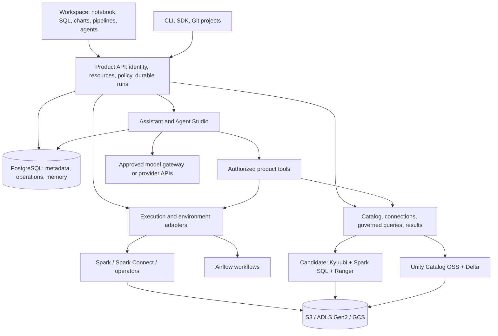

**A Kubernetes data and AI workspace: consolidated component plan**

Research snapshot: September 24–25, 2026. Target: teams within one organization using an existing Kubernetes cluster and their own cloud lake. This is the current component recommendation, incorporating the complete conversation. Components and integration profiles still require implementation and qualification; no production stack or performance benchmark has been delivered by this research.

**Recommendation.** Build a complete workspace around real Spark and open lakehouse components. Own the resource model, authoring experience, execution lifecycle, governance integration and recovery. Package advanced capabilities as supported modules within the same product. The unit of support must be a tested combination of engine, table format, catalog, authentication, policy enforcement and storage—not an arbitrary collection of individually installable Helm charts.

The strongest product hypothesis is a self-hosted workspace that lets a team connect its lake, ingest data, develop pipelines, analyze results and build agents without operating each backend through a separate console. Kubernetes deployment and inexpensive learning are useful capabilities; they do not by themselves establish demand. [Stackable](https://docs.stackable.tech/home/stable/) already integrates a Kubernetes data stack, and [OpenLakeForge](https://github.com/malon64/openlakeforge) is a direct, currently alpha, batch-lakehouse comparison. Validate our advantage through complete workflows with pilot teams.

**Working names.**

| Preference | Platform | Assistant | Assessment |
|---|---|---|---|
| Recommended | **LakeMantle** | **Sylun** | A layer around the lake, with a short companion name; no prominent same-category exact match surfaced in the limited searches |
| Alternative | **LakeMason** | **Nivru** | Strong building association; geographic search noise and an existing personal GitHub handle |
| Conditional | **DataRafter** | **Vyruli** | Preserves a “Data + structural object” feel; Rafter alone has existing software and data-services uses |

These are preliminary web-screened suggestions, not cleared or registered names. Sylun is an invented brand suggestion, not a claimed mythological name or translation. A small floating light/messenger character can preserve the magical-guide idea. Proposed product labels are LakeMantle Workspace, SQL, Pipelines, Agent Studio, Sylun and Sylun Code. Prior DataSlate/Doot filenames remain historical working artifacts. [Full name screen and evidence](research-names.md).

**The token-efficiency project is probably Headroom.** The likely match is [Headroom](https://github.com/headroomlabs-ai/headroom), an Apache-2.0 context-compression project with library, proxy and MCP interfaces. Use a pinned library adapter optionally inside our AI request path. Its compression is distinct from durable memory. Keep the product responsible for identities, memory permissions, provider credentials and action authorization. Published savings are the upstream project's claims; our own tasks need correctness, latency and total-cost measurements.

**Logical architecture.** These boxes are responsibilities, not a requirement to create a microservice for every box.

**Application and authoring components.** “Build” means product-specific engineering remains necessary; choosing a library does not supply the complete feature.

| Component | Selected foundation | What we build |
|---|---|---|
| Workspace and design system | React + TypeScript | Navigation, project tabs, command palette, accessibility, themes, search, resource pages and consistent permissions/status |
| Notebook | Reusable JupyterLab notebook/cell/output components; Jupyter Server/kernel APIs | Compute attachment, autosave, revisions, cell execution, output history, reconnect, package environment, scheduling and assistant actions |
| SQL editor | CodeMirror 6 with SQL support | Authorized schema completion, parameters, statement results, query history, error navigation and explain/profile views |
| Collaboration | Qualified Jupyter collaboration/Yjs integration | Document permissions, persistence, presence, comments and conflict-aware edits; document sharing does not share kernel credentials |
| Result tables | AG Grid Community | Typed cell rendering, authenticated server-backed blocks, sorting/filtering, limits, exports and saved column settings |
| Visualization | Apache ECharts | Chart authoring, field selection, backend aggregation, chart tabs, filters and publication |
| Result service | Custom API; Arrow IPC and typed JSON fallback | Durable result manifests, paging, schema fidelity, cancellation, TTL, policy-aware reuse, aggregation and exports |
| Dashboards | Native React modules using the same result/chart components | Layout, parameters, filters, versioned publication, access, refresh and data freshness |
| Metrics and business semantics | Versioned resources in PostgreSQL/Git | Metrics, dimensions, joins, calendars, units, owners, examples and compilation through governed queries |
| Files, Git and project bundles | Git repositories, notebook files and declarative manifests | Source revisions, review/promotion, parameterized projects and reproducible deployment |
| Public API and CLI | Go API/controller; OpenAPI; Python SDK and generated clients | One resource contract, OAuth login, idempotency, pagination, optimistic concurrency and resumable status streams |

JupyterLab explicitly supports component reuse. AG Grid Community does not include its commercial integrated charts, pivoting or advanced server-side row model; ECharts supplies rendering while our backend supplies chart computation. CodeMirror's GitHub archival reflects its 2026 migration to Forgejo, not an abandoned editor. [Jupyter components](https://jupyterlab.readthedocs.io/en/stable/extension/components.html), [AG Grid row models](https://www.ag-grid.com/react-data-grid/row-models/), [ECharts datasets](https://echarts.apache.org/handbook/en/concepts/dataset/), [CodeMirror migration](https://discuss.codemirror.net/t/codemirrors-migration-to-forgejo/9706).

Start with Python and SQL notebook profiles. Scala/JVM and other language profiles need their own kernel, Spark and package qualification. Preserve notebook MIME outputs for approved Python chart libraries, with active content isolated. Keep restricted outputs out of broadly shared Yjs/document state; code collaboration, execution credentials and output permissions are separate. Familiar Databricks workflows are the interaction reference; our implementation needs its own supported API and behavior contract.

**Compute, storage and engineering components.**

| Component | Selected foundation | Deployment/integration contract |
|---|---|---|
| Distributed batch processing | Upstream Apache Spark | Immutable SparkApplication per attempt; controller records native application and pod identity |
| Spark operator | Apache Spark Kubernetes Operator for compatible new installs; Kubeflow adapter for existing supported installs | Discover exact CRD group/version, controller, scope and permissions; managed or external ownership |
| Interactive Spark | Jupyter kernels + Spark Connect | Authenticated gateway, isolated sessions and qualified long-running applications; no public unauthenticated Connect endpoint |
| Governed SQL | **Candidate A: Kyuubi + Spark SQL + Ranger** | Private services and controlled Spark engines; complete UC/policy integration must pass release gates |
| Catalog | Unity Catalog OSS | Durable metadata, cloud credentials and engine adapters; product supplies integrated browse/permissions/lineage views |
| Default new table format | Delta Lake | Parquet data files with explicit Snappy writer policy; transactions, schemas and history through supported Delta APIs |
| Existing object lake | S3, ADLS Gen2 or GCS | Qualified S3A/ABFS/GCS connectors plus actual driver/executor/catalog identity integration |
| Discovery | Custom connection and discovery service | Read catalogs first; bounded file discovery, schema inference, protocol/feature checks, source ownership and freshness |
| Iceberg compatibility | Native Iceberg through a separately supported authoritative catalog | Preserve existing Iceberg tables; certify version/features and reads/writes separately |
| Alternative full lakehouse profile | Iceberg v2 + Polaris + Trino/OPA | Independently qualified option; not a silent substitute for the requested UC/Delta profile |
| Native acceleration | Optional Apache DataFusion Comet | Separate pinned Spark runtime, differential correctness and authorization tests; vanilla Spark remains the reference |
| Runtime/package builds | BuildKit workers + existing OCI registry; Harbor optional | Locked dependencies, signed image digests, SBOM, provenance, scan policy and isolated builds |
| Batch ingestion | dlt OSS extraction + controlled Spark publication | Persist extraction state; stage, validate, commit and publish through one owned write path |
| Kafka ingestion | Spark Structured Streaming | Stable exclusive checkpoints, bronze Delta event records and deterministic curated transformations |
| Database CDC | Optional Debezium + Kafka Connect | Source-specific snapshots, offsets, deletes, schema change and recovery contracts |
| Kafka infrastructure | Existing Kafka preferred; Strimzi optional | A supported streaming module, not a mandatory control-plane dependency |
| Declarative pipelines | Spark Declarative Pipelines | Native pipeline authoring, dependency graph, quality rules, incremental state and run UI |
| Quality and contracts | Product rules executed through Spark/SQL | Freshness/schema/uniqueness/null/business checks, quarantine, evidence and checks before publication where promised |
| Workflows and scheduling | Airflow, managed or external; disabled mode supported | Native DAG/run/task UI through supported APIs; trusted generated DAGs dispatch isolated user workloads |
| Maintenance | Custom reconciler invoking format-native operations | Compaction, statistics, metadata/snapshot cleanup, retention checks, schedules and audit |
| Lineage | OpenLineage event capture + product lineage projection | Correlate supported execution events, source/code/output versions and completeness; external lineage backend optional |

The starting runtime **candidate** is Spark 4.1.3 / Scala 2.13 / Delta 4.4.0 with its Spark-4.1-specific artifacts, matching UC and Kyuubi authorization artifacts, and a qualified JDK/Python image. This is not an already compatible release bundle. Delta's generic artifact and UniForm support differ by Spark line. [Delta 4.4 release](https://github.com/delta-io/delta/releases/tag/v4.4.0), [Kyuubi requirements](https://kyuubi.readthedocs.io/en/v1.12.0/quick_start/quick_start.html).

Two Spark operators expose differently grouped SparkApplication resources. Apache 1.0.0 uses `spark.apache.org/v1` and documents Kubernetes 1.34–1.36 support; Kubeflow uses `sparkoperator.k8s.io/v1beta2`. Kyuubi also manages its own SQL engine lifecycle, which is not automatically represented by operator-managed SparkApplications. Include ZooKeeper for the documented Kyuubi HA profile. [Apache release](https://github.com/apache/spark-kubernetes-operator/releases/tag/1.0.0), [Kyuubi Kubernetes engines](https://kyuubi.readthedocs.io/en/v1.12.0/deployment/engine_on_kubernetes.html), [Kyuubi HA](https://kyuubi.readthedocs.io/en/v1.12.0/deployment/high_availability_guide.html).

Airflow-generated tasks should submit through our execution API. Its adapter owns the operator-specific resource shape and maps task attempts to product runs. This avoids assuming a stock Airflow Spark operator targets both CRD APIs. Airflow owns workflow dependencies and whole-job retries when enabled; the execution adapter must not independently repeat the entire job.

Photon itself is not a reusable OSS component. Comet is our first native-acceleration evaluation candidate; Gluten/Velox is an alternative to compare if justified. Neither establishes Databricks performance or semantic parity. Connect also lacks some classic APIs, including SparkContext/RDD access; provide separate qualified batch profiles for such packages. [Photon](https://docs.databricks.com/aws/en/compute/photon), [Comet compatibility](https://github.com/apache/datafusion-comet/blob/1.0.0/docs/source/user-guide/latest/compatibility/index.md), [Spark Connect](https://spark.apache.org/docs/latest/spark-connect-overview.html).

S3, ADLS and GCS are object storage. Attached block storage serves databases, logs, caches and temporary workloads. Existing JSON, Parquet, Delta and Iceberg datasets remain in their original formats; connecting a lake must not silently convert it or assume maintenance rights. JSON is a file format, Snappy a codec, and Delta/Iceberg table protocols. Reading every Parquet file inside a transactional table can produce incorrect results. [Storage and discovery specification](cloud-lake-and-ai-experience.md).

New ingestion defaults to the requested Delta + Snappy-Parquet policy. This is our explicit product default, not a claim that all current Databricks managed tables default to Snappy; Databricks changed some new-table defaults to Zstd in October 2025. Each cloud write profile must qualify commit coordination, restart/retry behavior and credentials. Maintenance must respect external readers, stream lag and retained history. [Databricks release note](https://docs.databricks.com/aws/en/release-notes/product/2025/october), [Delta catalog-managed tables](https://docs.delta.io/delta-catalog-managed-tables/).

**Identity, security and operations components.**

| Component | Selected foundation | Required product behavior |
|---|---|---|
| SSO | Existing OIDC provider; optional Keycloak | Browser PKCE/server sessions, groups, machine identities, token validation, deprovisioning and revocation |
| Resource authorization | Product policy/grant service in PostgreSQL | Workspaces, projects, connections, code, runs, secrets, agents and publication privileges |
| Data authorization | Qualified catalog/engine policy adapters; Ranger in candidate A | Row filters, column masks, table grants and policy propagation verified in the execution path |
| Kubernetes isolation | Namespaces, workload service accounts, RBAC, NetworkPolicy and admission controls | Restrict executor identities, mounts, images, secrets, egress and resource use; separate privilege boundaries |
| Secrets | Existing cloud secret manager; External Secrets Operator where appropriate; optional OpenBao | Secret references, scoped access, rotation and audit; prefer workload federation when supported |
| Product state | PostgreSQL with separate service databases/roles | Resource metadata, durable outbox, operations, policy, checkpoints and memory; controlled migrations |
| Managed database option | CloudNativePG + Barman Cloud plugin | Explicit backup, restore, failover and upgrade contracts; external production PostgreSQL is preferred when available |
| TLS and routing | Existing ingress/Gateway implementation; cert-manager optional | Private service endpoints, certificate lifecycle, websocket/gRPC compatibility and custom CAs |
| Observability | OpenTelemetry, Spark event logs and existing metrics/log backends | Correlated product/engine/provider runs, redaction, budgets, failure evidence and support bundles |
| Optional telemetry bundle | Prometheus/Grafana and qualified log/trace backends | Separate capacity, retention, access and distribution-license choices; no automatic full-stack install |
| Installation | Helm + product preflight/capability controller | Managed/external dependency plan, version checks, canary, readiness and actionable failures |
| GitOps and upgrades | Rendered manifests, explicit ownership and migration jobs | One desired-state owner per object; separate CRD lifecycle; canary upgrades and recovery procedures |
| Storage inside Kubernetes | Optional separately provisioned Rook/Ceph | Administrator-owned storage profile with devices/failure domains; existing cloud lake remains the normal path |

External Secrets Operator can integrate existing secret stores; it does not remove the need to protect any materialized Kubernetes Secrets. BuildKit and Harbor are useful build/registry foundations, not automatic isolation or package-trust guarantees. [External Secrets](https://external-secrets.io/latest/), [OpenBao Kubernetes](https://openbao.org/docs/2.4.x/platform/k8s/), [BuildKit](https://github.com/moby/buildkit), [Harbor](https://github.com/goharbor/harbor), [cert-manager](https://cert-manager.io/docs/).

**The most important unresolved gate is governance.** UC OSS plus Delta plus Kyuubi/Ranger is the closest-fit candidate, but available Kyuubi Delta tests use Hive/DeltaCatalog rather than demonstrating the complete UC combination. We must verify catalog naming, effective-user propagation, row/column rules, SQL escape restrictions, cloud credentials and native acceleration together. If that fails, fix the integration or explicitly revise the supported profile before advertising protected multi-team SQL. [Kyuubi authorization](https://kyuubi.readthedocs.io/en/v1.12.0/security/authorization/spark/overview.html), [Delta authorization tests](https://github.com/apache/kyuubi/blob/v1.12.0/extensions/spark/kyuubi-spark-authz/src/test/scala/org/apache/kyuubi/plugin/spark/authz/ranger/DeltaCatalogRangerSparkExtensionSuite.scala).

An analyst can receive filtered results through the governed SQL service and notebook query API. Giving the same person arbitrary Python plus credentials to read the underlying complete Parquet files defeats that row-level boundary. Raw-data engineering therefore requires explicit full-input privileges or a separate approved execution identity. Caches, logs, exports, dashboards, notebook outputs, memory and AI prompts are also data surfaces. Namespace boundaries alone do not enforce table permissions. [Detailed security architecture](research-security-catalog.md).

**AI, agents and memory components.** This entire capability is configurable; ordinary engineering must work with AI disabled.

| Component | Selected foundation | What we build |
|---|---|---|
| Ask-data assistant | Product semantic registry + governed SQL tools + model adapters | Domain spaces, evidence-backed answers, ambiguity handling, charts and benchmark questions |
| Code assistant | Same provider/tool infrastructure, specialized context assembly | Cell suggestions, explain/fix, SQL help, test proposals, contextual troubleshooting and reviewed diffs |
| Agent Studio | Native UI + LangGraph OSS | Templates, instructions, tools, memory scopes, environments, tests, publishing, versions and rollback |
| Durable agent execution | LangGraph PostgreSQL checkpointer + product run/action records | Resume, cancellation, bounded retries, approvals where configured and idempotent tool effects |
| Long-term memory | Permission-aware product service on PostgreSQL + pgvector/full-text search | Typed facts/episodes, provenance, correction, scope, retention, deletion and current-access checks |
| Context optimization | Optional pinned Headroom library middleware | Per-request compression policy, protected exact content, secure retrieval of originals and measured savings |
| Advanced memory option | Hindsight adapter after evaluation | Integration with existing identity/provenance/deletion model; not another default authority |
| Tools and MCP | Typed product tool broker + qualified MCP clients/servers | Audience-bound auth, scoped downstream credentials, approved tool versions, action receipts and egress controls |
| Model connections | Existing organizational gateway or explicit provider adapters | Capability discovery, credentials, streaming, tool schema handling, limits, retry policy, usage and cost controls |
| Knowledge retrieval | PostgreSQL/pgvector + scoped object artifacts | Authorized indexing, embeddings, freshness, source citations and hybrid retrieval; live metrics use SQL |
| Evaluation and tracing | MLflow | Permission-aware traces, datasets, prompt/agent versions, regression tests and promotion decisions |
| Agent endpoints | Ordinary isolated Kubernetes Deployments initially | Product authentication, caller/run-as semantics, health, resource limits, rollout and scheduled execution |

Support provider APIs such as OpenAI, Anthropic, xAI, Azure-hosted models, Vertex AI and Bedrock through their documented authentication and capabilities. Gateway OAuth may use client credentials, private-key JWT or token exchange where the endpoint supports it. JWT is a token format, not one universal login protocol. Do not exchange a workspace ID token for arbitrary downstream access or assume a personal ChatGPT/Claude/Grok subscription supplies a shared application API. Approved Codex/Claude clients can separately access our API/MCP tools where their supported integration allows it. [Provider and authentication analysis](research-ai-experience.md).

LangGraph checkpoints resume execution; long-term memories serve later tasks. Approved procedures remain versioned instructions rather than automatically learned policy. MLflow supplies trace/evaluation infrastructure, but its documented logical workspaces do not automatically create hard infrastructure isolation. [LangGraph memory](https://docs.langchain.com/oss/python/concepts/memory), [MLflow workspaces](https://mlflow.org/docs/latest/self-hosting/workspaces).

The context sequence should be: authenticate caller → select authorized sources/memory → construct bounded task context → optionally compress eligible content → invoke approved model → dispatch authorized tools → record evidence and results. Keep exact active code, SQL, identifiers, policy and action arguments available. Start compression on repetitive logs and tool listings. Disable cross-agent auto-sharing and unreviewed instruction-learning in the initial Headroom adapter. This is a proposed safety/quality policy, not an assertion that the library enforces our permissions.

Remember source references and dates; re-query changing lake data. A memory created from restricted evidence must retain those restrictions. Revocation must affect memory retrieval and resumed checkpoints; deletion must propagate to derivative summaries and queued consolidation. The Memory UI should show sources, scope, freshness, conflicts, correction/forget controls and context usage. Hindsight is a useful optional candidate with Helm support, but its basic API-key extension uses a shared schema; tenancy requires deliberate integration. [Hindsight extensions](https://hindsight.vectorize.io/developer/extensions), [full memory analysis](research-agent-memory.md).

**Visualization is a core execution feature.** SQL results, notebook `display(df)` and assistant answers share one panel: **Table · Visualize · Profile · Execution**. Named chart tabs, field pickers, aggregation, filters and “Add to dashboard” must work without configuring a second BI application. Initial charts include line, bar, area, scatter, histogram, heatmap, pie/donut and KPI/table. Databricks' result visualization behavior provides a useful reference. [Databricks visualizations](https://docs.databricks.com/aws/en/visualizations/).

The Result Service records source revision, query/plan reference, engine/runtime, data snapshot where available, effective principal, policy version, schema, limits and provenance. SQL/data snapshots cannot always be pinned across every external source; show that limitation instead of inventing repeatability. Arrow preserves typed data, while our service owns access and lifecycle. [Arrow format](https://arrow.apache.org/docs/format/Columnar.html).

When a chart needs complete-data aggregates, execute them through the authorized backend. A preview/sample chart must say so. Sorting or filtering only the loaded browser rows must not appear to filter the whole result. Never implement unrestricted Spark display using `collect()` or `toPandas()`. Large exports should stream through controlled result jobs. [Spark toPandas](https://spark.apache.org/docs/latest/api/python/reference/pyspark.sql/api/pyspark.sql.DataFrame.toPandas.html).

Persist chart definitions separately from data. A dashboard can rerun a saved query under current viewer rights, or expose an explicitly permissioned snapshot. An in-memory DataFrame needs a persisted result or reproducible transformation before publishing as a refreshing dashboard. When its session disappears, either restore the retained result or clearly report it unavailable. Notebook errors, partial results and prior-revision outputs remain distinguishable. [Full result and chart contract](research-results-visualization.md).

**Modules needed for broader Databricks-like coverage.** These extend the same UI and resource model, but should not all become mandatory installation dependencies.

| Capability | Proposed component/profile | Additional work or limit |
|---|---|---|
| Experiments, model registry and batch inference | MLflow + supported training libraries + Spark/Kubernetes Jobs | Dataset/model versions, artifact permissions, reproducibility and evaluation |
| Online model/LLM serving | Optional KServe + qualified runtimes; vLLM for appropriate LLMs | GPU scheduling, model licenses, auth, rollout, capacity and per-profile scaling tests |
| Feature store | Optional Feast; PostgreSQL online store for an initial small profile | Qualify offline lake/Delta integration, point-in-time training retrieval, materialization, freshness and access |
| Distributed GPU training | Separate future runtime/operator profile chosen for actual workloads | Avoid installing a second general compute framework without a demonstrated use case |
| Larger AI search | Begin with PostgreSQL/pgvector; add a dedicated search adapter if measured scale requires it | Index synchronization, filters, relevance, isolation and delete propagation remain product work |
| Federation | Optional Trino or explicitly qualified source adapters | Separate query federation from catalog federation; expose dialect and pushdown limits |
| dbt transformations | Later adapter against certified SQL targets | Match adapter version, dialect, catalog and grants; do not assume every Spark endpoint is interchangeable |
| App hosting | Isolated Kubernetes Deployments for approved Python/Node images | Authenticated routes, resource binding, per-app permissions, builds, logs and release lifecycle |
| Operational PostgreSQL | Existing PostgreSQL or optional CloudNativePG application databases | Useful OLTP capability; ordinary PostgreSQL does not reproduce Lakebase's complete managed architecture |
| Cross-organization sharing | Optional Delta Sharing implementation/profile | Recipient identities, credentials, revocation, audit and supported table features need a separate contract |
| Clean rooms and marketplace | Separate later product initiatives | They require security protocols, collaboration models and ecosystem work beyond selecting one backend |

Feast documents PostgreSQL online storage; its transforms and lake integration still need our runtime qualification. KServe documents integrations for serving and vLLM, with deployment-specific limitations rather than universal autoscaling. [Feast architecture](https://docs.feast.dev/getting-started/architecture/overview), [Feast PostgreSQL](https://docs.feast.dev/reference/online-stores/postgres), [KServe integrations](https://kserve.github.io/website/docs/reference/integrations), [KServe multi-node limits](https://kserve.github.io/website/docs/model-serving/generative-inference/multi-node), [Delta Sharing](https://github.com/delta-io/delta-sharing).

**Installation and support boundaries.**

An administrator selects capabilities and sees each dependency's owner, version, capacity request, persistence, connectivity and readiness. Required capabilities cannot be disabled without an alternative provider. Managed installation is explicit; an existing operator is adopted only after compatibility and permission tests, and its CRDs are not silently upgraded. Keep installation settings distinct from team quotas and project defaults. Include an Effective settings view showing inheritance and locked organization constraints.

Small scale means independently scalable workers, idle session shutdown, quotas, bounded queues and optional modules. HA PostgreSQL, Kyuubi/ZooKeeper, workflow services and observability still have a meaningful baseline. Measure idle and active footprints for each supported profile before publishing minimum cluster sizes. A complete Kubernetes counterpart may simply be a Deployment or Job; it does not always need another operator.

An ingestion-to-dashboard journey should have one correlated run history across connector, Spark, Airflow, publication and chart refresh. One scheduler owns each schedule; one layer owns whole-job retries. A controller losing an observation must reconcile before reporting failure or repeating a commit. AI edits use the same source revisions and operation APIs as human edits. Kubernetes reconcilers must recover accepted work after restarts.

Maintain a versioned software bill of materials with redistribution obligations, notices, support status and upgrade ownership. Do not count AG Grid Enterprise features as Community capabilities, Airbyte's ELv2 stack as a permissive OSS default, or a project-root license as covering every bundled component. The detailed operations note records the current license and maintenance findings. [Operations and licensing research](research-integrations-operations.md).

**Build order and release evidence.**

1. Prove one complete runtime/governance profile: two users with different row/column rights, correct cloud commits, notebook/SQL parity, denied raw-file bypass and restart recovery. This resolves the highest-risk dependency choice.
2. Deliver the complete authoring journey: connect lake → ingest → notebook/SQL → shared table/chart results → schedule → inspect failure → publish. Build UI/API/CLI against the same contracts.
3. Complete production operations: quotas, credential rotation, audit, backup/restore, installation over supported existing services, cancellation, upgrades and stream recovery.
4. Deliver the AI module as a complete lifecycle: ask data, contextual cell assistance, Agent Studio, memory, tests, reviewed tool actions, durable resume and published endpoints. Benchmark Headroom as an optional optimization.
5. Expand certified storage/runtime/connector profiles and optional ML/serving/features/sharing modules based on pilot demand. Record partial support instead of claiming universal compatibility.

Release gates must include wrong-user cache access, policy changes after checkpoint creation, Spark credential bypass, exact numeric chart aggregates, preview sampling disclosure, failed/uncertain commits, duplicate callbacks, session loss, operator/controller upgrades and recovery from backups. No test in this research has established these outcomes yet. A seamless product is feasible; its defensible value will be the verified consistency of these workflows and operations.

Related specifications: [master architecture](kubernetes-lakehouse-product-blueprint.md), [cloud storage/ingestion/AI experience](cloud-lake-and-ai-experience.md), [internal agent lifecycle](research-dataslate-agents.md), [major Databricks feature inventory](databricks-mini-platform-feasibility.md). The initial local-first recommendation in the last document is superseded by this Kubernetes scope.
